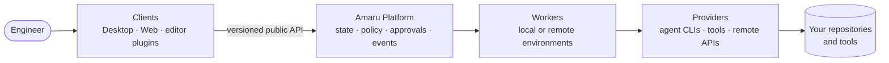

# Amaru

**An engineering execution platform where the engineer stays the maestro.**

Amaru coordinates humans, AI agents, tools, knowledge, workflows and execution environments across the software development lifecycle. Humans set intent, scope, quality criteria and approval boundaries; agents carry out delegated work inside explicit policies; workflows coordinate multi-step activities; and every result, decision and piece of evidence stays observable and auditable.

Amaru does not replace Git, GitHub, issue trackers, IDEs, CI or specialized engineering tools. It integrates with them and orchestrates work across them.

> **Status: product foundation.** This repository contains product scope, a proposed architecture, a decision log, engineering governance and a documentation checker. **No part of the Amaru Platform, Desktop, Web client, Cloud or Self-hosted offering is implemented here yet.** The working predecessor — a Go Runtime and an Obsidian plugin — lives in [`rluders/weave-obsidian`](https://github.com/rluders/weave-obsidian) and continues independently; selected parts may be migrated later under an [explicit plan](docs/migration/MIGRATION_PLAN.md).

## The problem

Work delegated to AI agents and tools is scattered across terminals, chats, CI logs and scripts. There is rarely one record of what an agent was asked, with which context, what it changed and who accepted it; permissions and approvals differ per tool; multi-step work is stitched together by hand and lost on a crash; specialized tools are stuck on specific machines; and workflows get written against a single agent vendor. Details: [PRD §2](docs/product/PRD.md#2-problem).

## Principles

- **Human authority**: consequential actions require explicit, recorded human authorization ([ADR-0006](docs/architecture/adr/0006-human-authorization-for-consequential-actions.md)).
- **Evidence over claims**: results carry the context, inputs, outputs and approvals that produced them.
- **Orchestrate, don't replace**: your repositories and tools stay authoritative.
- **Vendor-neutral**: workflows reference capabilities, not vendors.
- **Incremental**: infrastructure is added when evidence demands it, not in advance.

Intended users: individual engineers working with AI agents first; team leads, self-host operators and plugin authors later ([PRD §3](docs/product/PRD.md#3-target-users)).

## Product surfaces

| Surface | What it is | Status |
|---|---|---|
| **Amaru Platform** | The deployable system: domain model, API contracts, policies, execution coordination. | Proposed |
| **Amaru Self-hosted** | The Platform, operated by you. | Direction |
| **Amaru Cloud** | The Platform, operated as a managed service. | Direction |
| **Amaru Desktop** | Native client of the Platform (Tauri v2 + Rust host under evaluation, not decided). | Direction |
| **Plugins** | UI extensions, integrations, capabilities/providers, environment adapters. | Direction |

Cloud and Self-hosted are deployments of the same Platform, not separate products ([ADR-0002](docs/architecture/adr/0002-one-platform-multiple-deployment-models.md), proposed). Clients never own execution state ([ADR-0003](docs/architecture/adr/0003-desktop-is-a-client.md), proposed).

## Architecture at a glance (proposed)



Full proposal, with what exists only in Weave and what is not built: [docs/architecture/ARCHITECTURE.md](docs/architecture/ARCHITECTURE.md).

## Repository layout

```
.agents/skills/     canonical agent Skills (.claude/skills/ holds symlinks to them)
docs/product/       PRD, glossary
docs/architecture/  architecture, roadmap, decisions (adr/), open questions
docs/engineering/   conventions, repository layout, validation, agent instructions
docs/security/      security model
docs/migration/     Weave migration plan and inventory snapshot
tools/doccheck/     offline documentation checker (Go, standard library only)
```

Application, service and package directories are added only when they have real content ([repository layout](docs/engineering/repository-layout.md)).

## Getting started

Requirements: Git and Go 1.27 or newer (Go 1.21+ with the default `GOTOOLCHAIN=auto` downloads 1.27 automatically; verified here with Go 1.24.7). On Windows, clone with symlinks enabled: `git clone -c core.symlinks=true …` ([why](docs/engineering/agent-instructions.md#why-symlinks-and-the-windows-caveat)).

```sh
make check        # gofmt, go vet, unit tests and documentation checks
make docs-check   # documentation checks only
```

That is everything that runs today. Start reading at the [PRD](docs/product/PRD.md), then the [architecture](docs/architecture/ARCHITECTURE.md) and the [roadmap](docs/architecture/ROADMAP.md).

## Documentation

- Product: [PRD](docs/product/PRD.md) · [Glossary](docs/product/GLOSSARY.md)
- Architecture: [Architecture](docs/architecture/ARCHITECTURE.md) · [Roadmap](docs/architecture/ROADMAP.md) · [Decisions](docs/architecture/DECISIONS.md) · [Open questions](docs/architecture/OPEN_QUESTIONS.md)
- Engineering: [Conventions](docs/engineering/CONVENTIONS.md) · [Validation](docs/engineering/validation.md) · [Agent instructions](docs/engineering/agent-instructions.md)
- Security: [Security model](docs/security/SECURITY_MODEL.md)
- Migration: [Plan](docs/migration/MIGRATION_PLAN.md) · [Weave inventory](docs/migration/weave-inventory.md)

## Contributing

The project is at the foundation stage and is not yet accepting external contributions: the license and contribution terms are undecided. For maintainers and agents: follow [AGENTS.md](AGENTS.md) and the [conventions](docs/engineering/CONVENTIONS.md), record significant decisions as ADRs, and run `make check` before proposing a change.

## License

**No license has been chosen yet.** Until a license file is added, all rights are reserved by the copyright holder; no permission to use, copy, modify or distribute is granted. The intended direction is a source-available community license with separate commercial licensing; this is an [open decision](docs/architecture/OPEN_QUESTIONS.md#q12-licensing-and-commercial-boundaries), and Amaru should not be described as OSI-approved open source.
