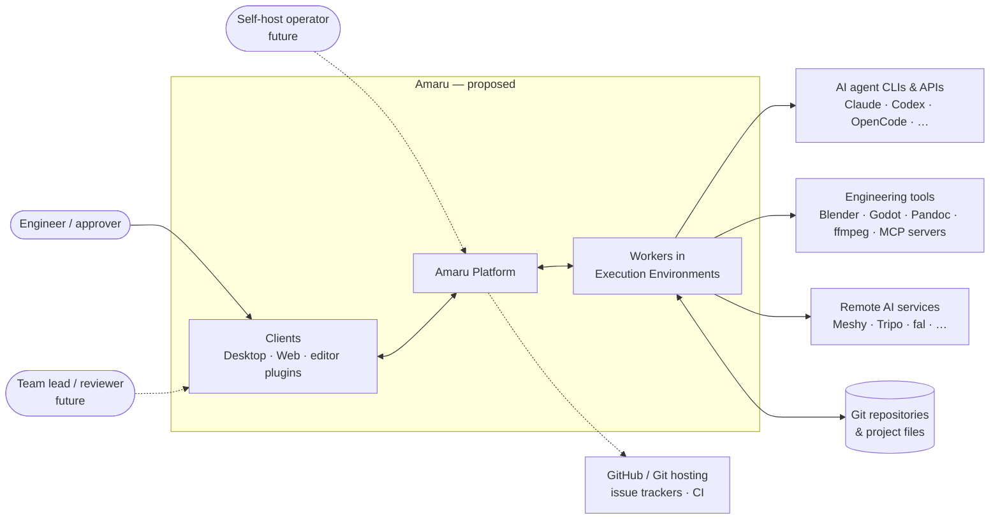
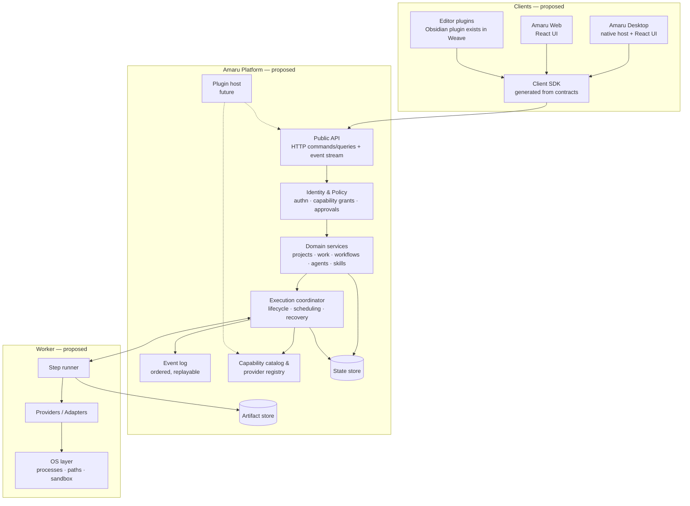
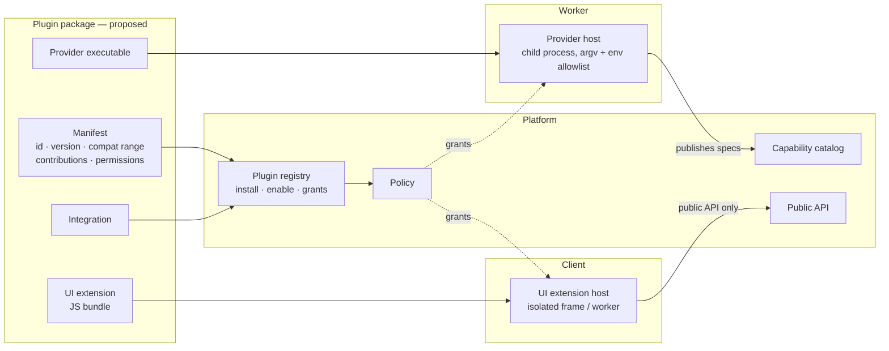
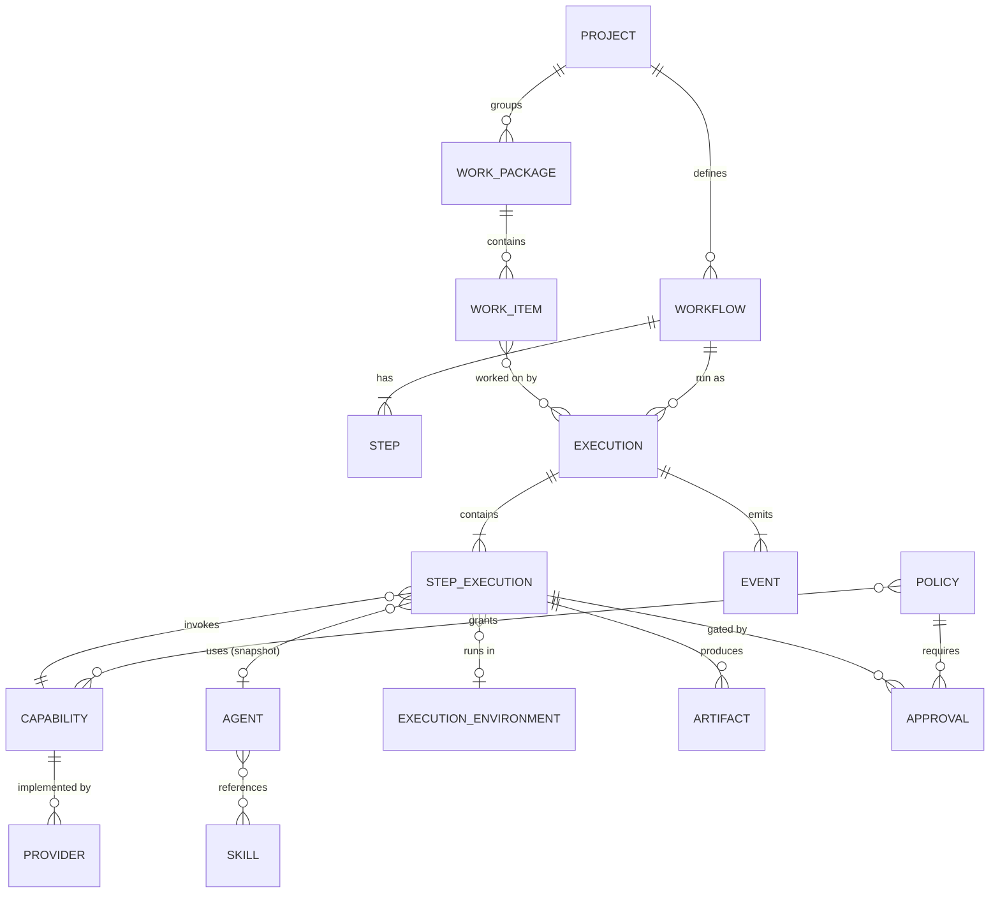
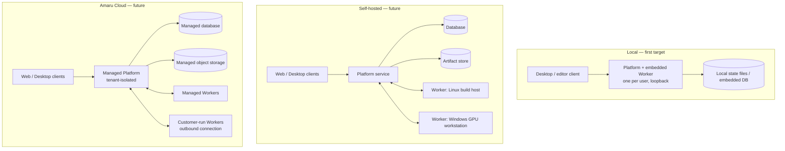
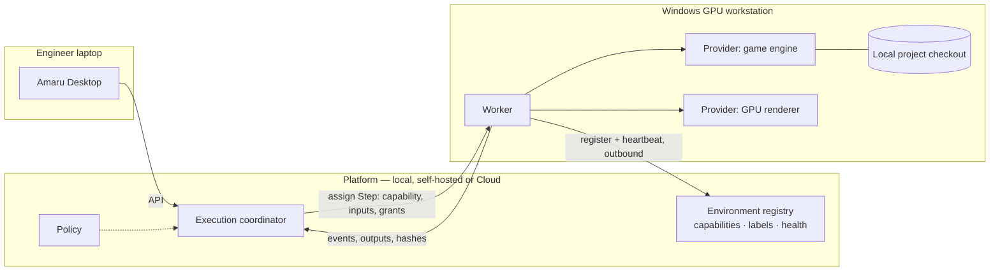
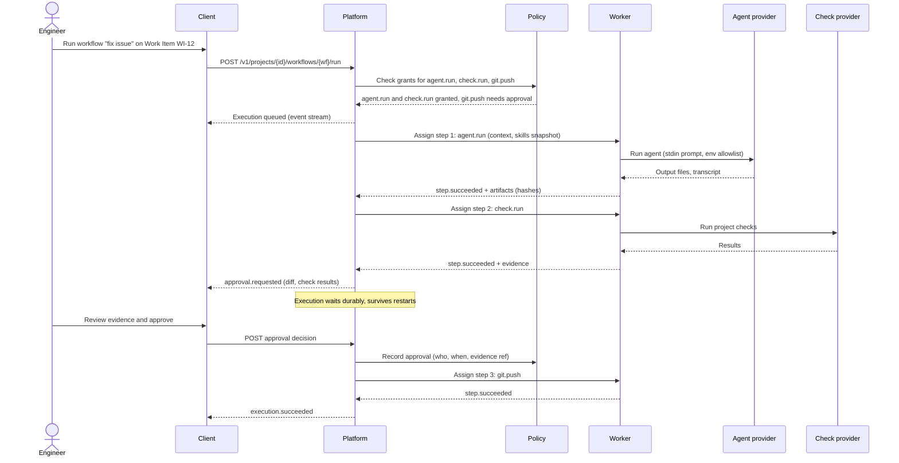

# Amaru — Proposed Architecture

Status: **proposed** (2026-10-24). **No component in this document is implemented in this repository.** The only code here is the documentation checker in `tools/doccheck`.

Labels used throughout:
- **[Weave]** the behavior exists in the predecessor [`weave-obsidian`](https://github.com/rluders/weave-obsidian) at the [inventory snapshot](../migration/weave-inventory.md); it is evidence for the design, not code in Amaru.
- **[Proposed]** a design direction recorded here or in a proposed ADR; not built anywhere.
- **[Open]** an unresolved choice tracked in [OPEN_QUESTIONS](OPEN_QUESTIONS.md).

Terms: [glossary](../product/GLOSSARY.md). Requirements: [PRD](../product/PRD.md). Decisions: [DECISIONS](DECISIONS.md).

## 1. Architectural drivers

1. Humans keep authority over consequential actions (PRD §4, [ADR-0006](adr/0006-human-authorization-for-consequential-actions.md)).
2. One domain model and one set of contracts across local, self-hosted and Cloud deployments ([ADR-0002](adr/0002-one-platform-multiple-deployment-models.md), [ADR-0004](adr/0004-shared-versioned-contracts.md), proposed).
3. Clients never own execution state ([ADR-0003](adr/0003-desktop-is-a-client.md), proposed).
4. Adding a Provider changes no core code, contract shape or UI architecture **[Weave: recorded for Tripo, Codex and OpenCode]**.
5. Start as a single local process; add infrastructure only on measured need ([ADR-0008](adr/0008-incremental-monorepo-layout.md), proposed).

## 2. System context

Amaru sits between the engineer and existing tools. Project files and Git stay authoritative; Integrations with Git hosting and trackers are **[Proposed]** and read/link rather than replace.

## 3. Logical components

| Component | Responsibility | Must not | Evidence |
|---|---|---|---|
| Clients | Present state, collect intent and approvals, call the API. | Spawn processes; hold domain logic; own execution state. | [Weave] plugin rule "never spawns processes or holds domain logic". |
| Public API | Versioned commands, queries and event stream; the only entry point for clients. | Encode client-specific concepts. | [Weave] `/v1` OpenAPI + JSON Schema + fixtures. |
| Identity & Policy | Authenticate callers; decide Capability grants; create and resolve Approvals. | Be bypassed by any path, including internal triggers (webhooks, schedules). | [Weave] bearer token only; Policy and Approval are [Proposed]. |
| Domain services | Projects, Work Packages/Items, Workflows, Agents, Skills, context assembly. | Import OS, vendor or transport packages. | [Weave] `domain`/`app` purity enforced by an architecture test. |
| Execution coordinator | Execution/Step state machine, ordering, cancellation, restart and resume. | Execute tools itself. | [Weave] `app` manager + persisted executions. |
| Event log | Ordered Events per Execution and per Project; replay for clients and audit. | Contain secrets. | [Weave] `events.jsonl` per execution, WS replay. |
| Capability catalog & registry | Typed Capability specs; resolve a Capability to an available Provider. | Reference a vendor from a Workflow. | [Weave] `domain/capabilities.go`, `GET /v1/capabilities`. |
| Worker | Run a Step through a Provider in one Execution Environment; report Events and outputs. | Decide policy; mutate domain state directly. | [Weave] in-process; separate Workers are [Proposed]. |
| Providers / Adapters | Translate a Capability call into a concrete tool or API call. | Leak vendor fields into the domain; read secrets except via the secrets port. | [Weave] packages under `runtime/internal/provider` + external protocol. |
| Plugin host | Load and isolate plugins; enforce declared permissions. | Exist before the extension model is decided. | [Open] Q6/Q7. |

## 4. Platform and Worker boundary

In Weave, the per-user Runtime is both coordinator and worker in one Go process **[Weave]**. Amaru separates the two **roles** in its contracts so that Steps can later run elsewhere, without requiring separate processes on day one **[Proposed]**:

- The **Platform** owns state: what should run, what has run, who approved what.
- A **Worker** owns a run: it receives a Step assignment (Capability, inputs, policy-limited grants, output location), runs it through a Provider, streams Events, and returns outputs. It holds no authoritative domain state.
- The local deployment may embed a Worker in the Platform process (Weave's model). Whether that remains the default is [Q10](OPEN_QUESTIONS.md#q10-remote-execution-environments).

The Worker contract is the **Provider contract one level up**: Weave's `CapabilityProvider` with `Resumable` / `Detachable` and the external `weave.provider/v1` stdio protocol already model "run elsewhere, report back, survive restarts" for remote jobs. That is the starting evidence for the Worker protocol design.

## 5. Desktop and Web clients

- **Amaru Desktop [Proposed]**: a native host providing OS integration (tray, notifications, local file pickers, starting/stopping the local Platform) around a React + TypeScript UI. Tauri v2 with a Rust host is the leading candidate, **not decided** ([Q5](OPEN_QUESTIONS.md#q5-desktop-framework)). The Desktop **may supervise** a local Platform process but talks to it only through the public API, exactly like any other client ([ADR-0003](adr/0003-desktop-is-a-client.md), proposed).
- **Amaru Web [Proposed]**: the same React UI served for self-hosted and Cloud deployments.
- **Shared code [Proposed]**: contracts and a generated client SDK (`packages/contracts`, `packages/sdk`), and a UI component library (`packages/ui`) — introduced when the first client is built, not before ([repository layout](../engineering/repository-layout.md)).
- **Editor plugins**: the Weave Obsidian plugin remains a client of the Weave Runtime. Whether it becomes an Amaru client is a migration decision ([MIGRATION_PLAN](../migration/MIGRATION_PLAN.md)).

Rule: anything a client can do, it does through the public API. A native host gets no private channel into Platform state.

## 6. Plugin and extension model

Amaru distinguishes extension **kinds**, because they have different trust and runtime needs **[Proposed]**:

| Kind | Runs where | Example | Status |
|---|---|---|---|
| Provider | Worker | A new agent CLI, a game-engine adapter | [Weave] built-in packages + external executables (`weave.provider/v1`) |
| Capability spec | Platform catalog | `mesh.from_text`, `doc.convert` | [Weave] catalog entries + provider-published specs |
| Integration | Platform | Git hosting, issue tracker, CI status | [Proposed] |
| UI extension | Client | A panel for a domain-specific Artifact viewer | [Proposed] |
| Environment adapter | Worker | Expose a GPU workstation's tools | [Proposed] |

Principles:
- Plugins depend on **Amaru contracts**, never on the Desktop framework ([ADR-0005](adr/0005-plugin-extensibility-independent-of-desktop.md), proposed). A UI extension written for Desktop works on Web.
- Out-of-process by default for executable code (Weave's external providers are child processes over stdio). In-process plugins need a sandbox decision first ([Q6](OPEN_QUESTIONS.md#q6-plugin-sandboxing-and-execution-isolation)).
- A plugin gets only the permissions it declared and the user granted; distribution and signing are [Q7](OPEN_QUESTIONS.md#q7-plugin-distribution-signing-permissions-and-compatibility).
- Weave's rule stands: a new Capability is a catalog entry or a provider-published spec, never a new core interface.

## 7. Domain model

**[Weave]** implements every entity except Execution Environment, Approval and Policy. Snapshots matter: Weave stores the Agent and Skill versions used by each Step Execution so a later edit cannot rewrite history; Amaru keeps that rule.

## 8. API and event boundaries

- **Commands and queries**: HTTP + JSON, versioned by path (`/v1`), described by OpenAPI with shapes in JSON Schema **[Weave]**. Within a major version: additive changes only; clients ignore unknown fields and event types **[Weave]**.
- **Events**: an ordered stream per Execution and per Project with replay from a cursor **[Weave: WebSocket]**. Transport for remote and multi-user deployments is [Q11](OPEN_QUESTIONS.md#q11-api-compatibility-and-versioning).
- **Golden fixtures**: every schema has fixtures validated by tests in each consuming language **[Weave: Go + TS]**. Amaru keeps this as a release gate ([ADR-0004](adr/0004-shared-versioned-contracts.md)).
- **Provider protocol**: a separate, versioned contract between Worker and external Providers **[Weave: `weave.provider/v1`]**.
- **Worker protocol** (Platform ↔ remote Worker): **[Proposed]**, not designed.
- No client-specific concepts (Obsidian, Tauri, React) appear in any contract.

## 9. Identity, authentication, authorization, trust

| Boundary | Local (MVP) | Self-hosted / Cloud (future) |
|---|---|---|
| Client → Platform | Loopback bind, per-start bearer token in a user-only discovery file **[Weave]** | User identity (OIDC or similar) and sessions [Open] |
| Platform → Worker | In-process | Mutually authenticated, Worker identity registered by an admin [Proposed] |
| Worker → Provider | Child process with argv, cwd, env allowlist; secrets via a port **[Weave]** | Same, plus per-environment sandboxing [Open] |
| Agent → Capability | Not enforced **[Weave GAP-09]** | Policy grants checked before start [Proposed, MVP requirement FR-24] |
| Consequential action | Explicit user start only **[Weave]** | Approval Step + Policy ([ADR-0006](adr/0006-human-authorization-for-consequential-actions.md)) |

Trust rules: project files, Skills, tool output and plugin code are untrusted **[Weave]**; secrets never appear in Events, logs or Artifacts **[Weave]**. Full model: [SECURITY_MODEL](../security/SECURITY_MODEL.md).

## 10. Persistence and artifact storage

- **[Weave]** stores state as JSON/YAML files under each project's `.weave/` and the user state directory; execution history is `execution.json` + `events.jsonl`. SQLite was deferred "until a measured need".
- **[Proposed]** the Platform owns persistence behind storage ports, so local file/embedded storage and a server database can coexist without changing domain code. The engine choice per deployment is [Q3](OPEN_QUESTIONS.md#q3-database-and-persistence-strategy).
- **Artifacts**: project-relative files stay in the Project; generated outputs go to a Platform-assigned output location; the Platform computes hashes **[Weave]**. Object storage for large or remote Artifacts is [Q4](OPEN_QUESTIONS.md#q4-artifact-and-object-storage-strategy).
- Must be designed before the MVP: retention, redaction of sensitive provider output, schema versioning and migration of persisted state **[Weave GAP-07]**.

## 11. Workflow durability and recovery

Requirements (PRD FR-12, NFR-3):
- Every Step state transition is persisted before it is acknowledged.
- After a Platform restart, each non-terminal Step is either resumed (Provider supports `Resumable`, e.g. a remote job id) or ended in an explicit state with a reason; never silently re-run when re-running is unsafe **[Weave: `runtime_restarted`, Resumable/Detachable]**.
- Approval waits must survive restarts and be resumable for days **[Proposed]**.
- Idempotency: Step assignment carries an id so a Worker can detect duplicates **[Proposed]**.

Whether this stays a hand-written state machine over local storage or moves to a durable workflow engine (Temporal or alternatives) is [Q1](OPEN_QUESTIONS.md#q1-durable-workflow-technology). The Weave state machine is the baseline the engine must beat on simplicity for local use.

## 12. Observability and auditability

- Events are the audit backbone: who started what, which Policy granted it, which Approval released it, which Provider ran it, which Artifacts it produced (hashes) **[Partly Weave]**.
- Evidence per Execution: assembled context, Agent/Skill snapshots, inputs, outputs, validation results **[Weave]**.
- Structured logs without secrets **[Weave]**; metrics and tracing for server deployments **[Proposed]**, technology [Open].
- UI rule from Weave: show only real state; unimplemented areas are explicit empty states.

## 13. Deployment topologies

All three run the **same Platform** with the same contracts ([ADR-0002](adr/0002-one-platform-multiple-deployment-models.md), proposed); they differ in storage adapters, identity provider and Worker placement. Customer-run Workers that connect outbound to Cloud are how specialized machines stay reachable without inbound firewall holes **[Proposed]**.

## 14. Remote execution environments

**[Proposed]**, nothing built. Open points ([Q10](OPEN_QUESTIONS.md#q10-remote-execution-environments)): how a Worker gets the right project revision (Git checkout vs file sync), secrets on remote machines, interactive tools that need a desktop session, and network partitions during long Steps.

## 15. Representative workflow execution

A Workflow with an agent Step, a local check Step and an Approval Step before a push.

**[Weave]** implements the run, agent Step, tool Step, Events and evidence. **[Proposed]**: Policy check, Approval Step, `check.run` and `git.push` as Capabilities, and the separate Worker.

## 16. Security considerations

See [SECURITY_MODEL](../security/SECURITY_MODEL.md). Highest-risk areas for the architecture: prompt injection from project content steering agents toward consequential Capabilities (mitigated by Policy + Approval, not by prompt hygiene alone); plugin code execution; remote Workers holding secrets; webhook and scheduled triggers bypassing Approval (they must go through the same Policy path).

## 17. Failure modes and recovery expectations

| Failure | Expected behavior |
|---|---|
| Platform crash mid-Step | On restart, Step resumed if Provider is Resumable, else marked interrupted with reason; no silent re-run of unsafe Steps. **[Weave]** |
| Worker lost (remote) | Lease expires; Step marked lost or reassigned only if declared idempotent. [Proposed] |
| Provider hangs | Per-Step timeout and cancel; process tree terminated. **[Weave, Linux validated; Windows unvalidated]** |
| Approval never given | Execution waits indefinitely, visible as waiting; can be cancelled; optional expiry by Policy. [Proposed] |
| Client disconnects | No effect on Executions; client reconnects and replays Events from its cursor. **[Weave]** |
| Contract mismatch | Client detects incompatible version and shows an explicit state, never undefined behavior. **[Weave]** |
| Storage corruption / partial write | Atomic writes; on unreadable state, refuse to start that Project with a clear error. **[Partly Weave]** |
| Remote API outage | Step fails with Provider error; remote job resumable when the API returns. **[Weave, against fakes]** |

## 18. Trade-offs

- **Single process first vs separate services.** Simpler to install and debug; costs a later split. Mitigated by keeping Platform and Worker roles separate in contracts.
- **Files/embedded storage vs a server database.** Zero-ops locally; weaker for multi-user queries. Mitigated by storage ports.
- **Hand-written durable state machine vs workflow engine.** Full control, no extra infrastructure; the engine gives retries, timers and history for free but adds an operational dependency. Decided by [Q1](OPEN_QUESTIONS.md#q1-durable-workflow-technology).
- **Out-of-process plugins vs in-process.** Stronger isolation and language freedom; costs latency and packaging work.
- **Native Desktop host vs Web-only.** OS integration and local supervision; costs a second build/release pipeline.

## 19. Decisions still open

Tracked in [OPEN_QUESTIONS](OPEN_QUESTIONS.md): durable workflow technology, queues/messaging, persistence, artifact storage, desktop framework, plugin sandboxing, plugin distribution, tenant isolation, self-hosted operations, remote environments, API versioning, licensing. Proposed ADRs awaiting approval: [DECISIONS](DECISIONS.md).
