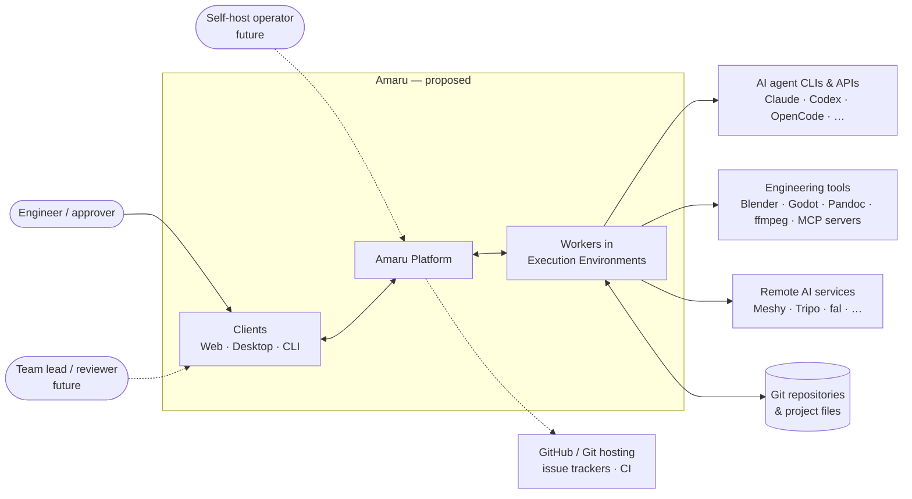
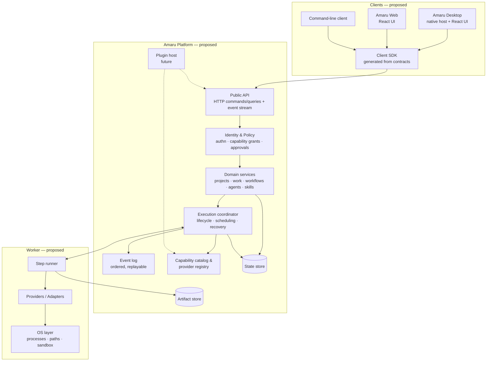
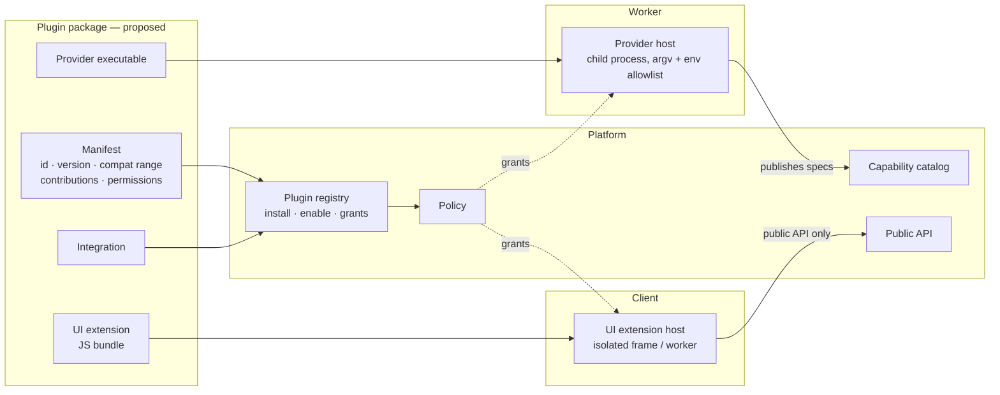
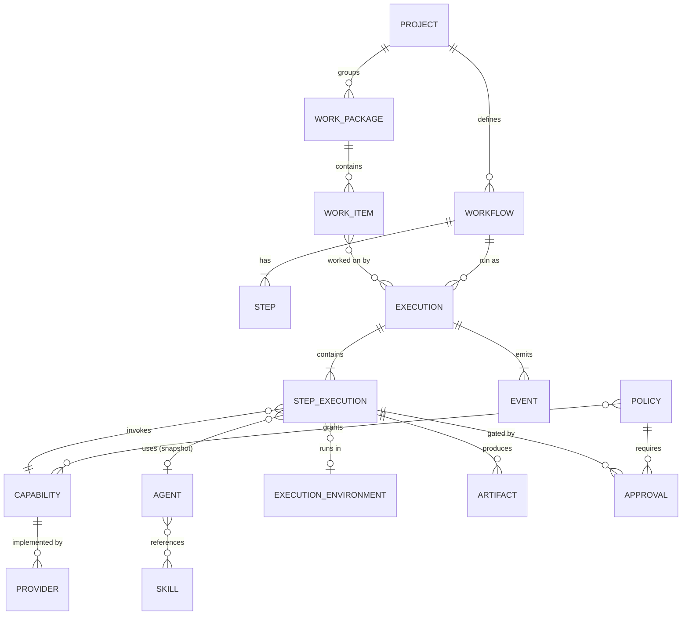
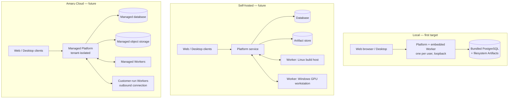
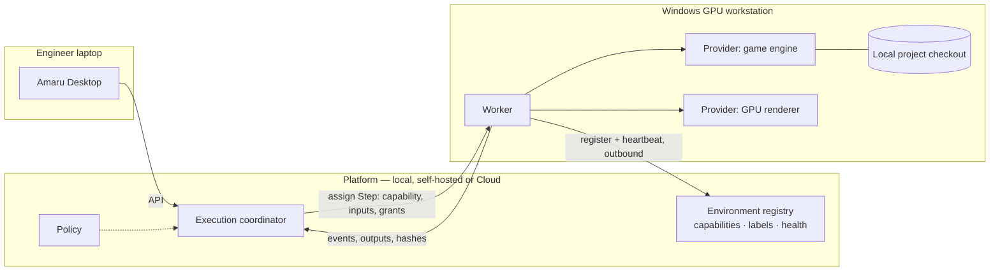
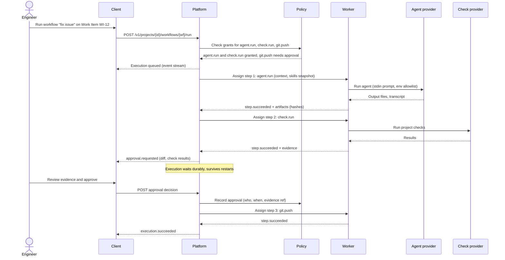

# Amaru — Proposed Architecture

Status: **accepted** (decisions recorded 2026-10-25, [§19](#19-decisions)); the title keeps "Proposed" because nothing is built. **No component in this document is implemented in this repository.** The only code here is the documentation checker in `tools/doccheck`.

Labels used throughout:
- **[Prototype]** the behavior exists in an earlier internal prototype; it is evidence for the design, not code in Amaru.
- **[Proposed]** a design direction recorded here or in an ADR (accepted or not); not built anywhere.
- **[Open]** an unresolved choice tracked in [OPEN_QUESTIONS](OPEN_QUESTIONS.md). None remain as of 2026-10-25 (Q1–Q54 closed).

Terms: [glossary](../product/GLOSSARY.md). Requirements: [PRD](../product/PRD.md), [feature catalog](../product/FEATURE_CATALOG.md), [NFRs](../product/NON_FUNCTIONAL_REQUIREMENTS.md). Decisions: [DECISIONS](DECISIONS.md). Delivery: [ROADMAP](ROADMAP.md), [WORK_PACKAGES](WORK_PACKAGES.md).

This document is the hub. Detailed views:

| Topic | Document |
|---|---|
| Domain model, entities, lifecycles | [DOMAIN_MODEL](DOMAIN_MODEL.md) |
| Plugins and extensions | [EXTENSIBILITY](EXTENSIBILITY.md) |
| Workers and remote environments | [EXECUTION_ENVIRONMENTS](EXECUTION_ENVIRONMENTS.md) |
| Data classes and storage criteria | [DATA_ARCHITECTURE](DATA_ARCHITECTURE.md) |
| Topologies and operations | [DEPLOYMENT](DEPLOYMENT.md) |
| Web and Desktop | [CLIENTS](CLIENTS.md) |
| Failure and recovery | [RESILIENCE](RESILIENCE.md) |
| Technology evaluation | [TECHNOLOGY_BENCHMARK](TECHNOLOGY_BENCHMARK.md) |
| Trust boundaries | [SECURITY_MODEL](../security/SECURITY_MODEL.md) |

The **[Prototype]** label refers to the earlier internal Runtime and to a second, earlier prototype.

## 1. Architectural drivers

1. Humans keep authority over consequential actions (PRD §4, [ADR-0006](adr/0006-human-authorization-for-consequential-actions.md)).
2. One domain model and one set of contracts across local, self-hosted and Cloud deployments ([ADR-0002](adr/0002-one-platform-multiple-deployment-models.md), [ADR-0004](adr/0004-shared-versioned-contracts.md)).
3. Clients never own execution state ([ADR-0003](adr/0003-desktop-is-a-client.md)).
4. Adding a Provider changes no core code, contract shape or UI architecture **[Prototype: recorded for Tripo, Codex and OpenCode]**.
5. Start as a single local process; add infrastructure only on measured need ([ADR-0008](adr/0008-incremental-monorepo-layout.md)).

## 2. System context

Amaru sits between the engineer and existing tools. Project files and Git stay authoritative; Integrations with Git hosting and trackers are **[Proposed]** and read/link rather than replace.

## 3. Logical components

| Component | Responsibility | Must not | Evidence |
|---|---|---|---|
| Clients | Present state, collect intent and approvals, call the API. | Spawn processes; hold domain logic; own execution state. | [Prototype] plugin rule "never spawns processes or holds domain logic". |
| Public API | Versioned commands, queries and event stream; the only entry point for clients. | Encode client-specific concepts. | [Prototype] `/v1` OpenAPI + JSON Schema + fixtures. |
| Identity & Policy | Authenticate callers; decide Capability grants; create and resolve Approvals. | Be bypassed by any path, including internal triggers (webhooks, schedules). | [Prototype] bearer token only; Policy and Approval are [Proposed]. |
| Domain services | Projects, Work Packages/Items, Workflows, Agents, Skills, context assembly. | Import OS, vendor or transport packages. | [Prototype] `domain`/`app` purity enforced by an architecture test. |
| Execution coordinator | Execution/Step state machine, ordering, cancellation, restart and resume. | Execute tools itself. | [Prototype] `app` manager + persisted executions. |
| Event log | Ordered Events per Execution and per Project; replay for clients and audit. | Contain secrets. | [Prototype] `events.jsonl` per execution, WS replay. |
| Capability catalog & registry | Typed Capability specs; resolve a Capability to an available Provider. | Reference a vendor from a Workflow. | [Prototype] `domain/capabilities.go`, `GET /v1/capabilities`. |
| Worker | Run a Step through a Provider in one Execution Environment; report Events and outputs. | Decide policy; mutate domain state directly. | [Prototype] in-process; separate Workers are [Proposed]. |
| Providers / Adapters | Translate a Capability call into a concrete tool or API call. | Leak vendor fields into the domain; read secrets except via the secrets port. | [Prototype] packages under `runtime/internal/provider` + external protocol. |
| Plugin host | Load and isolate plugins; enforce declared permissions. | Run third-party code inside the Platform or client process. | [Proposed] Tiers and signing: [ADR-0041](adr/0041-isolation-tiers-for-plugins-providers-and-steps.md), [ADR-0021](adr/0021-plugin-packaging-signing-permissions-and-compatibility.md). |

**Deployable units [Proposed, [ADR-0009](adr/0009-modular-monolith-platform-with-separate-worker-role.md)].** Logical components are not services:

| Unit | Contains | Process boundary |
|---|---|---|
| Platform | Public API, Identity & Policy, Domain services, Execution coordinator, Event log, Capability catalog and registry, Plugin registry, storage adapters, Web asset serving | One Go process; modules separated by enforced import rules |
| Worker | Step runner, Providers/Adapters, OS layer | Embedded in the Platform in compact mode; separate process (possibly remote) otherwise |
| Provider and adapter processes | External Providers, plugin `worker-adapter` / `local-adapter` components | Always child processes of a Worker |
| Extension hosts | Plugin `logic` in the `amaru plugin-host` process (Wasm, one per Organization, [ADR-0040](adr/0040-plugin-logic-runs-in-a-separate-plugin-host-process-built-with-javy.md)) and `ui` (isolated frames in clients) | Always separate from the Platform and the Desktop host |
| Service plugins | Operator-deployed plugin services | Separate processes with machine identity |
| Clients | Web, Desktop, CLI | Separate; public API only |

## 4. Platform and Worker boundary

In the prototype, the per-user Runtime is both coordinator and worker in one Go process **[Prototype]**. Amaru separates the two **roles** in its contracts so that Steps can later run elsewhere, without requiring separate processes on day one **[Proposed]**:

- The **Platform** owns state: what should run, what has run, who approved what.
- A **Worker** owns a run: it receives a Step assignment (Capability, inputs, policy-limited grants, output location), runs it through a Provider, streams Events, and returns outputs. It holds no authoritative domain state.
- The local deployment may embed a Worker in the Platform process (the prototype's model). It remains the default for compact installs and speaks the same Worker protocol messages in process ([ADR-0029](adr/0029-worker-protocol-over-websocket-and-protobuf.md)).

The Worker contract is the **Provider contract one level up**: the prototype's `CapabilityProvider` with `Resumable` / `Detachable` and the prototype's external stdio provider protocol already model "run elsewhere, report back, survive restarts" for remote jobs. That is the starting evidence for the Worker protocol design.

## 5. Desktop and Web clients

- **Amaru Web [Proposed]**: the **first-party client of the Local MVP**, a React + TypeScript UI served by the Platform (locally and for self-hosted/Cloud) ([ADR-0010](adr/0010-local-mvp-client-is-a-web-ui.md)). Starts from the **[Prototype]** dashboard's design system.
- **Amaru Desktop [Proposed]**: a native host providing OS integration (tray, notifications, local file pickers, keychain, starting/stopping the local Platform) around the same React UI, from M8. The shell is Tauri v2 with a thin Rust host ([ADR-0018](adr/0018-desktop-shell-is-tauri-v2.md)). The Desktop **bundles** the Platform binary as a sidecar and supervises it when the user runs a local Instance; a Desktop connected only to remote Instances never starts it. Either way it talks to the Platform only through the public API, exactly like any other client ([ADR-0003](adr/0003-desktop-is-a-client.md)).
- **Shared code [Proposed]**: contracts and a generated client SDK (`packages/contracts`, `packages/sdk`), and the product UI and component library — introduced with the Web client, shared when Desktop arrives ([repository layout](../engineering/repository-layout.md), [CLIENTS](CLIENTS.md)).
- **Editor plugins**: the prototype's Obsidian plugin stays a prototype-only client and is retired; Amaru has no Obsidian client ([ADR-0031](adr/0031-obsidian-plugin-is-retired.md)).

Rule: anything a client can do, it does through the public API. A native host gets no private channel into Platform state.

## 6. Plugin and extension model

Amaru distinguishes extension **kinds**, because they have different trust and runtime needs **[Proposed]**:

| Kind | Runs where | Example | Status |
|---|---|---|---|
| Provider | Worker | A new agent CLI, a game-engine adapter | [Prototype] built-in packages + external executables (stdio provider protocol) |
| Capability spec | Platform catalog | `mesh.from_text`, `doc.convert` | [Prototype] catalog entries + provider-published specs |
| Integration | Platform | Git hosting, issue tracker, CI status | [Proposed] |
| UI extension | Client | A panel for a domain-specific Artifact viewer | [Proposed] |
| Environment adapter | Worker | Expose a GPU workstation's tools | [Proposed] |

Principles:
- Plugins depend on **Amaru contracts**, never on the Desktop framework ([ADR-0005](adr/0005-plugin-extensibility-independent-of-desktop.md)). A UI extension written for Desktop works on Web.
- Out-of-process by default for executable code (the prototype's external providers are child processes over stdio). Plugin `logic` runs in a Wasm sandbox inside the separate `amaru plugin-host` process; no third-party code runs in the Platform process ([ADR-0041](adr/0041-isolation-tiers-for-plugins-providers-and-steps.md), [ADR-0040](adr/0040-plugin-logic-runs-in-a-separate-plugin-host-process-built-with-javy.md)).
- A plugin gets only the permissions it declared and the user granted; distribution and signing: [ADR-0021](adr/0021-plugin-packaging-signing-permissions-and-compatibility.md).
- the prototype's rule stands: a new Capability is a catalog entry or a provider-published spec, never a new core interface.
- A plugin is one package whose components declare targets (`ui`, `logic`, `service`, `worker-adapter`, `local-adapter`) and availability ([ADR-0012](adr/0012-plugin-package-with-targeted-components.md)). TypeScript is the primary extension language; native third-party extensions are out of scope. Full model: [EXTENSIBILITY](EXTENSIBILITY.md).

## 7. Domain model

**[Prototype]** implements every entity except Execution Environment and a general Policy; approval steps and grants exist on the prototype's dogfood branch (ADR-019, ADR-024). Snapshots matter: The prototype stores the Agent and Skill versions used by each Step Execution so a later edit cannot rewrite history; Amaru keeps that rule. The full model with Organizations, Workers, Leases, Plugins, lifecycles and ownership: [DOMAIN_MODEL](DOMAIN_MODEL.md).

## 8. API and event boundaries

- **Commands and queries**: HTTP + JSON, versioned by path (`/v1`), described by OpenAPI with shapes in JSON Schema **[Prototype]**. Within a major version: additive changes only; clients ignore unknown fields and event types **[Prototype]**.
- **Events**: an ordered stream per Execution and per Project with replay from a cursor **[Prototype: WebSocket]**. Remote and multi-user deployments use the same WebSocket stream with a resumable cursor ([ADR-0025](adr/0025-api-and-protocol-versioning-policy.md)); internally Events fan out over NATS ([ADR-0016](adr/0016-nats-jetstream-message-bus-embedded-in-compact-installs.md)).
- **Golden fixtures**: every schema has fixtures validated by tests in each consuming language **[Prototype: Go + TS]**. Amaru keeps this as a release gate ([ADR-0004](adr/0004-shared-versioned-contracts.md)).
- **Provider protocol**: a separate, versioned contract between Worker and external Providers **[Prototype: provider protocol]**.
- **Worker protocol** (Platform ↔ remote Worker): **[Proposed]**, drafted in [EXECUTION_ENVIRONMENTS](EXECUTION_ENVIRONMENTS.md#3-worker-lifecycle-and-protocol-draft) (outbound, pull, leases — [ADR-0013](adr/0013-outbound-pull-based-workers-with-leases.md)); transport is Protobuf over WebSocket ([ADR-0029](adr/0029-worker-protocol-over-websocket-and-protobuf.md)).
- No client-specific concepts (Obsidian, Tauri, React) appear in any contract.

## 9. Identity, authentication, authorization, trust

| Boundary | Local (MVP) | Self-hosted / Cloud (future) |
|---|---|---|
| Client → Platform | Loopback bind, per-start bearer token in a user-only discovery file **[Prototype]** | Launch code → session cookie locally ([ADR-0034](adr/0034-local-web-client-authentication-with-launch-code-and-cookie.md)); local accounts + OIDC, server-side sessions on servers ([ADR-0028](adr/0028-identity-local-accounts-oidc-and-opaque-tokens.md)) |
| Platform → Worker | In-process | Mutually authenticated, Worker identity registered by an admin [Proposed] |
| Worker → Provider | Child process with argv, cwd, env allowlist; secrets via a port **[Prototype]** | Same, plus rootless per-Step containers on server/Cloud Workers ([ADR-0041](adr/0041-isolation-tiers-for-plugins-providers-and-steps.md)) |
| Agent → Capability | Not enforced **[Prototype GAP-09]** | Policy grants checked before start [Proposed, MVP requirement FR-24] |
| Consequential action | Explicit user start only **[Prototype]** | Approval Step + Policy ([ADR-0006](adr/0006-human-authorization-for-consequential-actions.md)) |

Trust rules: project files, Skills, tool output and plugin code are untrusted **[Prototype]**; secrets never appear in Events, logs or Artifacts **[Prototype]**. Full model: [SECURITY_MODEL](../security/SECURITY_MODEL.md).

## 10. Persistence and artifact storage

- **[Prototype]** stores state as JSON/YAML files under a per-project definition folder and the user state directory; execution history is `execution.json` + `events.jsonl`. SQLite was deferred "until a measured need".
- **[Proposed]** the Platform owns persistence behind storage ports, with PostgreSQL as the only engine: bundled and supervised in compact installs, operator-provided or managed elsewhere ([ADR-0015](adr/0015-postgresql-is-the-only-database-bundled-in-compact-installs.md)). Ports remain so tests use fakes.
- **Artifacts**: project-relative files stay in the Project; generated outputs go to a Platform-assigned output location; the Platform computes hashes **[Prototype]**. **[Proposed]** content-addressed Artifact store with versions in PostgreSQL; filesystem adapter locally, S3-compatible (RustFS reference) on servers; generated outputs never land in the Project tree unless promoted ([ADR-0017](adr/0017-content-addressed-artifact-store-filesystem-or-s3.md)).
- Retention, redaction and schema versioning are decided **[Proposed]** (closes prototype GAP-07): retention is an Organization Policy setting per data class with defaults in [DATA_ARCHITECTURE §5](DATA_ARCHITECTURE.md); per-Lease secret values are redacted on the Worker before any Event, log or Artifact is emitted, plus pattern scanning; every persisted record carries a schema version with forward-only migrations ([ADR-0023](adr/0023-self-hosted-oci-image-atlas-migrations-operator-owned-backup.md)).
- Data classes, store roles and decision criteria: [DATA_ARCHITECTURE](DATA_ARCHITECTURE.md). The **[Prototype]** used PostgreSQL with sequential migrations; Amaru now uses PostgreSQL everywhere with Atlas-authored migrations ([ADR-0023](adr/0023-self-hosted-oci-image-atlas-migrations-operator-owned-backup.md)).

## 11. Workflow durability and recovery

Requirements (PRD FR-12, NFR-3):
- Every Step state transition is persisted before it is acknowledged.
- After a Platform restart, each non-terminal Step keeps waiting (Approval, timer, valid Lease), is resumed (Provider supports `Resumable`, e.g. a remote job id), is retried as a new Lease when its Capability is declared idempotent, or ends `interrupted` with a reason; never silently re-run otherwise ([ADR-0042](adr/0042-durable-execution-with-explicit-restart-semantics.md); **[Prototype: `runtime_restarted`, Resumable/Detachable]**).
- Approval waits must survive restarts and be resumable for days **[Proposed]**.
- Idempotency: Step assignment carries an id so a Worker can detect duplicates **[Proposed]**.

Amaru keeps a hand-written durable state machine adapted from the prototype, persisted in PostgreSQL with timers, Approval waits and a transactional outbox; no external workflow engine ([ADR-0042](adr/0042-durable-execution-with-explicit-restart-semantics.md)). Requirements, failure catalogue and test approach: [RESILIENCE](RESILIENCE.md); alternatives considered: [TECHNOLOGY_BENCHMARK](TECHNOLOGY_BENCHMARK.md).

## 12. Observability and auditability

- Events are the audit backbone: who started what, which Policy granted it, which Approval released it, which Provider ran it, which Artifacts it produced (hashes) **[Partly prototype]**.
- Evidence per Execution: assembled context, Agent/Skill snapshots, inputs, outputs, validation results **[Prototype]**.
- Structured logs without secrets **[Prototype]**; metrics and tracing **[Proposed]** with OpenTelemetry (OTLP) and a Prometheus endpoint; logs via `log/slog` JSON.
- UI rule from the prototype: show only real state; unimplemented areas are explicit empty states.

## 13. Deployment topologies

Detailed topologies (compact, compact self-hosted, distributed, Cloud) and operations: [DEPLOYMENT](DEPLOYMENT.md).

All three run the **same Platform** with the same contracts ([ADR-0002](adr/0002-one-platform-multiple-deployment-models.md)); they differ in storage adapters, identity provider and Worker placement. Customer-run Workers that connect outbound to Cloud are how specialized machines stay reachable without inbound firewall holes **[Proposed]**.

## 14. Remote execution environments

**[Proposed]**, nothing built. Protocol draft, sandboxing and examples: [EXECUTION_ENVIRONMENTS](EXECUTION_ENVIRONMENTS.md). Decided ([ADR-0024](adr/0024-remote-worker-registration-identity-and-delivery.md)): Git checkout at the recorded commit, per-Lease in-memory secrets, Workers inside the interactive session for desktop tools; network partitions are handled by Leases and resumable reconnects ([ADR-0013](adr/0013-outbound-pull-based-workers-with-leases.md), [ADR-0029](adr/0029-worker-protocol-over-websocket-and-protobuf.md)).

## 15. Representative workflow execution

A Workflow with an agent Step, a local check Step and an Approval Step before a push.

**[Prototype]** implements the run, agent Step, tool Step, Events and evidence. **[Proposed]**: Policy check, Approval Step, `check.run` and `git.push` as Capabilities, and the separate Worker.

## 16. Security considerations

See [SECURITY_MODEL](../security/SECURITY_MODEL.md). Highest-risk areas for the architecture: prompt injection from project content steering agents toward consequential Capabilities (mitigated by Policy + Approval, not by prompt hygiene alone); plugin code execution; remote Workers holding secrets; webhook and scheduled triggers bypassing Approval (they must go through the same Policy path).

## 17. Failure modes and recovery expectations

| Failure | Expected behavior |
|---|---|
| Platform crash mid-Step | On restart, waiting Steps keep waiting; Resumable Steps resume; idempotent Steps retry as a new Lease; all others end `interrupted` with a reason ([ADR-0042](adr/0042-durable-execution-with-explicit-restart-semantics.md)). **[Prototype, extended]** |
| Worker lost (remote) | Lease expires (30 s default); same rule as a restart: retried as a new Lease only if idempotent, else `interrupted` ([ADR-0042](adr/0042-durable-execution-with-explicit-restart-semantics.md)). [Proposed] |
| Provider hangs | Per-Step timeout and cancel; process tree terminated. **[Prototype: cancel and process-group kill exist; no wall-clock timeout on agent runs; Windows unvalidated]** |
| Approval never given | Execution waits indefinitely, visible as waiting; can be cancelled; the engine supports `expired` from M3 and Policy-configured expiry arrives with FEAT-REV-008. [Proposed] |
| Client disconnects | No effect on Executions; client reconnects and replays Events from its cursor. **[Prototype]** |
| Contract mismatch | Client detects incompatible version and shows an explicit state, never undefined behavior. **[Prototype]** |
| Storage corruption / partial write | Atomic writes; on unreadable state, refuse to start that Project with a clear error. **[Partly prototype]** |
| Remote API outage | Step fails with Provider error; remote job resumable when the API returns. **[Prototype, against fakes]** |

Full failure catalogue with detection and tests: [RESILIENCE §3](RESILIENCE.md#3-failure-catalogue).

## 18. Trade-offs

- **Single process first vs separate services.** Simpler to install and debug; costs a later split. Mitigated by keeping Platform and Worker roles separate in contracts.
- **One server database everywhere vs embedded storage locally.** One dialect, RLS and FTS everywhere; costs a bundled PostgreSQL process in compact installs. Chosen: PostgreSQL everywhere ([ADR-0015](adr/0015-postgresql-is-the-only-database-bundled-in-compact-installs.md)).
- **Hand-written durable state machine vs workflow engine.** Full control, no extra infrastructure; the engine gives retries, timers and history for free but adds an operational dependency. Chosen: own state machine on PostgreSQL ([ADR-0042](adr/0042-durable-execution-with-explicit-restart-semantics.md)).
- **Out-of-process plugins vs in-process.** Stronger isolation and language freedom; costs latency and packaging work. Chosen: out of process, including Wasm `logic` in the plugin-host process ([ADR-0040](adr/0040-plugin-logic-runs-in-a-separate-plugin-host-process-built-with-javy.md), [ADR-0041](adr/0041-isolation-tiers-for-plugins-providers-and-steps.md)).
- **Native Desktop host vs Web-only.** OS integration and local supervision; costs a second build/release pipeline.

## 19. Decisions

No architecture question is open; Q1–Q54 were closed on 2026-10-25 ([OPEN_QUESTIONS](OPEN_QUESTIONS.md), [DECISIONS](DECISIONS.md)). Summary of the accepted decisions that shape this document (none is implemented yet):

| Concern | Decision | ADR |
|---|---|---|
| Durable execution | Own state machine, persisted in PostgreSQL, transactional outbox; explicit restart rule | [0042](adr/0042-durable-execution-with-explicit-restart-semantics.md) |
| Database | PostgreSQL only; bundled and supervised in compact installs | [0015](adr/0015-postgresql-is-the-only-database-bundled-in-compact-installs.md) |
| Messaging | NATS JetStream, embedded in compact, cluster for multi-instance | [0016](adr/0016-nats-jetstream-message-bus-embedded-in-compact-installs.md) |
| Artifacts | Content-addressed store; filesystem or S3-compatible (RustFS reference) | [0017](adr/0017-content-addressed-artifact-store-filesystem-or-s3.md) |
| Desktop | Tauri v2 thin shell, M8 | [0018](adr/0018-desktop-shell-is-tauri-v2.md) |
| Isolation | Fixed tiers per plugin target; containers per Lease in `container`-class Environments | [0041](adr/0041-isolation-tiers-for-plugins-providers-and-steps.md) |
| Plugin logic | Javy-built QuickJS Wasm on wazero in a separate plugin-host process | [0040](adr/0040-plugin-logic-runs-in-a-separate-plugin-host-process-built-with-javy.md) |
| Plugin distribution | Signed OCI packages, declared permissions, engine ranges | [0021](adr/0021-plugin-packaging-signing-permissions-and-compatibility.md) |
| Tenancy | Row-level isolation per Organization (RLS) | [0022](adr/0022-cloud-tenancy-row-level-isolation-by-organization.md) |
| Self-hosted | OCI image, Atlas-authored migrations, operator-owned backup | [0023](adr/0023-self-hosted-oci-image-atlas-migrations-operator-owned-backup.md) |
| Remote Workers | Enrollment per Organization, Ed25519 identity, per-Lease delivery | [0024](adr/0024-remote-worker-registration-identity-and-delivery.md) |
| Versioning | Major versions, additive-only, 12-month overlap | [0025](adr/0025-api-and-protocol-versioning-policy.md) |
| License | Fair-code community license + commercial; Apache-2.0 SDKs | [0026](adr/0026-fair-code-community-license-with-commercial-licensing.md) |
| Project metadata | Definitions in `.amaru/` (Git); Teams and operational state in the Platform | [0043](adr/0043-project-definitions-in-git-teams-and-operational-state-in-platform.md) |
| Identity | Local accounts + OIDC, server-side sessions, opaque tokens | [0028](adr/0028-identity-local-accounts-oidc-and-opaque-tokens.md) |
| Worker transport | Protobuf over WebSocket (`coder/websocket`) | [0029](adr/0029-worker-protocol-over-websocket-and-protobuf.md) |
| Knowledge | Lexical PostgreSQL FTS over committed docs | [0030](adr/0030-knowledge-is-lexically-indexed-project-documentation.md) |
| Obsidian plugin | Retired | [0031](adr/0031-obsidian-plugin-is-retired.md) |
| Migration baseline | a pinned commit of the earlier implementation | [0032](adr/0032-migration-baseline-is-a-pinned-commit.md) |
| Usage and cost | Per-Step usage records with provenance | [0033](adr/0033-usage-and-cost-telemetry-model.md) |
| Local Web auth | Launch code → session cookie; Host/Origin checks | [0034](adr/0034-local-web-client-authentication-with-launch-code-and-cookie.md) |
| Agent placement | On the Worker beside tools, Worker-side MCP gateway | [0035](adr/0035-agents-run-beside-environment-hosted-tools.md) |
| Approvals | Human decisions bound to Evidence | [0036](adr/0036-approvals-bind-to-evidence-and-gate-work.md) |
| Policy | One evaluation of requests, Grants and Approvals | [0037](adr/0037-one-policy-evaluates-capabilities-grants-and-approvals.md) |
| Roles and Teams | Fixed roles, Teams, per-gate separation of duties | [0038](adr/0038-roles-teams-and-separation-of-duties.md) |
| Configuration | Deployment < Organization < Project < user, with locks | [0039](adr/0039-configuration-scopes-and-resolution-order.md) |

Observability technology (not an ADR-level dependency): OpenTelemetry (OTLP) traces and metrics, a Prometheus scrape endpoint, and structured JSON logs via Go `log/slog`.
