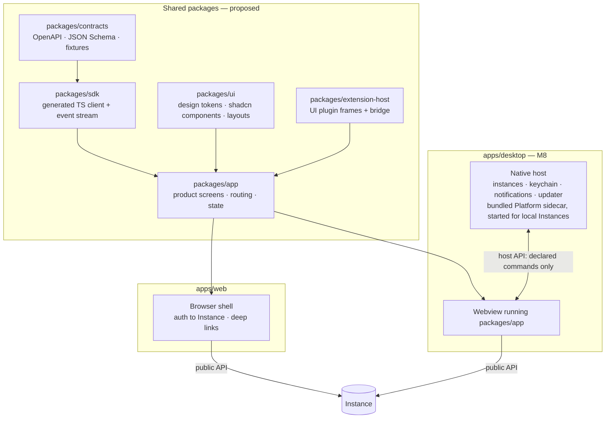

# Clients: Web and Desktop

Status: **accepted** (2026-10-25), not implemented. Extends [ARCHITECTURE §5](ARCHITECTURE.md#5-desktop-and-web-clients). The Local MVP client is **Amaru Web served by the Platform** ([ADR-0010](adr/0010-local-mvp-client-is-a-web-ui.md)). Desktop follows at M8 and wraps the same UI (Tauri v2, [ADR-0018](adr/0018-desktop-shell-is-tauri-v2.md)). Clients are clients ([ADR-0003](adr/0003-desktop-is-a-client.md)).

## 1. Layering

**Shared across clients:** contracts, SDK, design system, product screens, plugin UI host.

**Environment-specific:**
- authentication flow and token storage
- instance management
- native capabilities
- update mechanism
- local Platform supervision

Areas are created under [ADR-0008](adr/0008-incremental-monorepo-layout.md) rules. The product UI and component library start inside `apps/web` (M4) and are extracted into `packages/app` and `packages/ui` at M8 (roadmap E8.2), when Desktop is their second consumer; `packages/contracts` and `packages/sdk` exist from M2.

## 2. Web client (M4)

- **Stack.** React + TypeScript, with TanStack Router and Query, Tailwind and shadcn/ui. It starts from the Weave prototype dashboard (`weave` `dashboard/`: React 19, Vite, radix-nova style, oklch tokens, Geist font). See the [prototype inventory](../migration/weave-prototype-inventory.md) for what is reused or dropped.
- **Data.** All server access goes through the generated SDK. The prototype's per-feature raw `fetch` hooks are replaced. Live updates come from the event stream with cursor resume, a pattern taken from the Weave plugin's `runtime/connection.ts`.
- **Serving.** The local Platform serves the built assets from the same origin as the API, which avoids CORS. In self-hosted and Cloud the same assets are served behind the Instance's TLS endpoint.
- **Local authentication** ([ADR-0034](adr/0034-local-web-client-authentication-with-launch-code-and-cookie.md)):
  1. The Platform prints or opens a launch URL carrying a one-time code.
  2. The code is exchanged for an HttpOnly, SameSite=Strict session cookie bound to the loopback origin.
  3. Host and Origin header checks block DNS rebinding.
- **Scope of MVP screens** (FEAT-CLI-* P0):
  - Projects
  - Work Packages and Items
  - Workflow editor (text)
  - Execution timeline and logs
  - Approval inbox
  - diff and Evidence view
  - providers, Policy and Local Check settings
  - Instance health
- **Truthful UI.** No placeholder pages are presented as functional (NFR-38). The prototype's billing, roles, invitations and audit-log pages are not carried into M4.

## 3. Desktop client (M8)

| Responsibility | Desktop host does | Desktop host does not |
|---|---|---|
| Instances | Store several Instances, keep credentials in the OS keychain, switch Instances | Bypass the Instance's API |
| Local Platform | Bundle the Platform binary as a sidecar; start, stop and update it when the user runs a local Instance, and open it ([ADR-0018](adr/0018-desktop-shell-is-tauri-v2.md)); never start it for a Desktop connected only to remote Instances | Read or write Platform storage directly |
| Native capabilities | Notifications, file and folder pickers, deep links, tray, auto-update | Expose arbitrary shell or filesystem to the UI or plugins |
| Plugins | Host UI extension frames exactly as Web does | Load third-party native code |
| Offline | Show cached read-only state, marked as stale | Queue consequential actions for later |

- **Host API.** Native features are exposed to the webview only as an explicit, versioned command list with per-command permission checks. Tauri v2 capabilities scope permissions per window; app commands are additionally restricted in `build.rs` because they are otherwise reachable from every window (verified in the Tauri v2 docs, 2026-10-25; spike in M8).
- **Framework.** Tauri v2 with a thin Rust host ([ADR-0018](adr/0018-desktop-shell-is-tauri-v2.md)). Wails v3 (still beta) and Electron (larger footprint, broader attack surface) were rejected.

## 4. Compatibility and updates

- Clients read the Instance's contract version (FEAT-API-005). An incompatible Instance gets an explicit "update required" state.
- Web assets are versioned together with the Platform build that serves them. Desktop updates itself independently and supports a declared range of Instance versions (NFR-30).

## 5. Plugin UI integration

- **Isolation.** UI extensions run in sandboxed iframes hosted by `packages/extension-host` in both clients.
- **Bridge.** A message-RPC bridge exposes the plugin SDK, limited to the scopes granted to the plugin.
- **Contribution points.** Slots on Project, Work Item, Execution and Artifact pages, and Step forms in the workflow editor.
- **Theming.** Design tokens are passed in, so extensions can match the theme.

Details: [extensibility](EXTENSIBILITY.md#5-execution-models-per-target).

## 6. Resolved points

- **Desktop with a remote Instance**: the Desktop may run a separate local Worker process for local adapters; it is opt-in and enrolled with the remote Instance like any Worker ([ADR-0024](adr/0024-remote-worker-registration-identity-and-delivery.md)).
- **Offline**: read-only cached state marked as stale; no offline writes or queued consequential actions.
- **Accessibility**: WCAG 2.2 AA is the target for both shells; automated axe checks run in the UI end-to-end tests, plus a manual keyboard and screen-reader pass per release.
