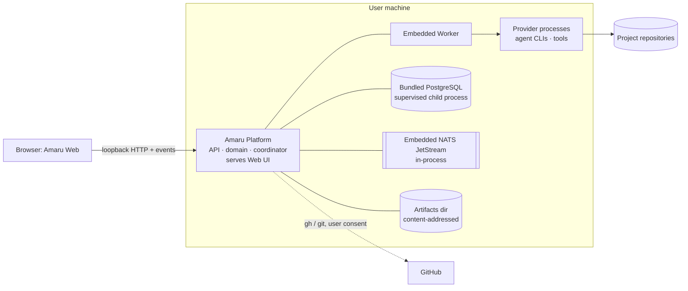
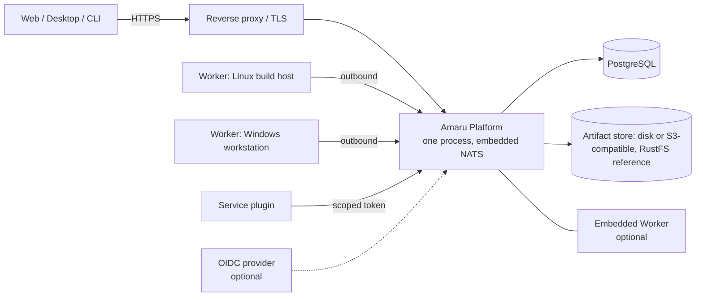
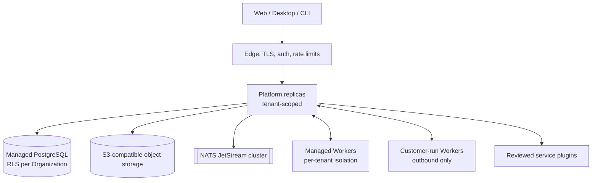

# Deployment and Operations

Status: **accepted** (2026-10-25). Nothing is deployable today. One Platform, one set of contracts, several topologies ([ADR-0002](adr/0002-one-platform-multiple-deployment-models.md)). Topologies differ in adapters, identity, Worker placement and infrastructure. They never differ in domain model or API.

## 1. Topologies

### 1.1 Compact (local single user) — Local MVP

### 1.2 Compact self-hosted (single server, small team) — M7

### 1.3 Distributed self-hosted — M9
- Several Platform replicas behind a load balancer. Coordination needs no leader: timers and assignments are claimed with `SKIP LOCKED` in PostgreSQL and delivered through JetStream work queues ([ADR-0042](adr/0042-durable-execution-with-explicit-restart-semantics.md), [ADR-0016](adr/0016-nats-jetstream-message-bus-embedded-in-compact-installs.md)).
- PostgreSQL, a NATS cluster (three nodes) and S3-compatible object storage, managed by the operator.
- A Worker pool per environment class.
- Packaged as the same OCI image; a Helm chart ships at M9 ([ADR-0023](adr/0023-self-hosted-oci-image-atlas-migrations-operator-owned-backup.md)).

### 1.4 Amaru Cloud — M9

The Cloud runs the same Platform build with Cloud adapters. Customer-run Workers connect outbound, so customer machines and networks stay reachable without inbound access ([ADR-0013](adr/0013-outbound-pull-based-workers-with-leases.md)).

## 2. Operations

| Concern | Compact | Server | Cloud | Feature |
|---|---|---|---|---|
| Packaging | Signed per-OS archive (zip/tar.gz), no admin rights; one binary + Web assets + pinned PostgreSQL binaries. Native installers arrive with Desktop (M8), which bundles the same binary | OCI image + reference compose (PostgreSQL, NATS, RustFS); plain binary also supported | Vendor pipeline | OPS-001, OPS-004 |
| Upgrades | Replace binary; migrations at start; refuse downgrade | Same, plus a pre-upgrade backup check | Rolling, zero-downtime via expand/contract migrations | OPS-006 |
| Schema migrations | Atlas-authored, embedded, applied at start; forward-only, tested on fixtures | Same | Same + expand/contract | OPS-002 |
| Backup / restore | Copy data dir while stopped, or `amaru backup` (pg_dump + artifacts); `amaru backup` is supported for compact installs only | Operator responsibility; Amaru documents scope (DB, artifacts, KMS key, config) and a restore drill | Vendor RPO ≤ 15 min, RTO ≤ 4 h (NFR-33) | OPS-005 |
| Configuration | File + env vars; scoped resolution ([ADR-0039](adr/0039-configuration-scopes-and-resolution-order.md)) | Same + Organization settings in DB | Same | OPS-003 |
| Secrets | OS keychain or user-only encrypted file | Envelope-encrypted in PostgreSQL; external vault optional | KMS key per Organization | POL-007 |
| Worker scaling | n/a | Manual registration with enrollment tokens | Autoscaled pools (M9): scale on queued assignments per pool | ENV-002 |
| Plugin deployment | Local components | Plus service plugins run by the operator | Reviewed services only | PLG-007, PLG-009 |
| Version compatibility | Client checks Instance version | Platform/Worker/plugin skew policy | Same | API-005 |
| Diagnostics | Diagnostics bundle | Same + metrics/tracing | Vendor observability | OBS-005, OBS-006 |

## 3. Rules

- Every infrastructure dependency has an accepted ADR. In compact mode it is embedded, bundled and supervised, or optional (NFR-34, NFR-39): PostgreSQL bundled ([ADR-0015](adr/0015-postgresql-is-the-only-database-bundled-in-compact-installs.md)), NATS embedded ([ADR-0016](adr/0016-nats-jetstream-message-bus-embedded-in-compact-installs.md)), object storage optional.
- The same contract fixtures run against every deployment adapter set in CI, once CI exists.
- Self-hosted is not a development mode. Its install, upgrade and restore paths are tested release gates from M7 on.

## 4. Resolved deployment points

- **Local operator subcommands** ship in the Platform binary from M3/M4: `amaru open` (launch code, [ADR-0034](adr/0034-local-web-client-authentication-with-launch-code-and-cookie.md)), `migrate`, `backup` (compact only), `import legacy`, `admin check`, `worker` and `plugin-host` ([ADR-0040](adr/0040-plugin-logic-runs-in-a-separate-plugin-host-process-built-with-javy.md)). The remote API client (FEAT-CLI-012) is M7.
- **Compact PostgreSQL**: supervised with `embedded-postgres` v2 over the bundled binaries; Unix socket on Linux/macOS, random loopback port + generated SCRAM password on Windows ([DATA_ARCHITECTURE](DATA_ARCHITECTURE.md)). If the M1 spike shows a bundled server cannot run without admin rights on an OS, the fallback is an installer-managed PostgreSQL service (validation A2).
- **One binary**: the Platform binary has a `worker` subcommand; Server and Cloud run the same image in both roles ([ADR-0023](adr/0023-self-hosted-oci-image-atlas-migrations-operator-owned-backup.md)).
- **Web UI in Cloud**: served by the Platform (same build as every deployment); a CDN may cache static assets in front of it. Contract compatibility rules apply either way.
- **Hosted offerings and licensing**: offering Amaru as a hosted service requires a commercial license; Amaru Cloud is operated by the vendor under it ([ADR-0026](adr/0026-fair-code-community-license-with-commercial-licensing.md)).
