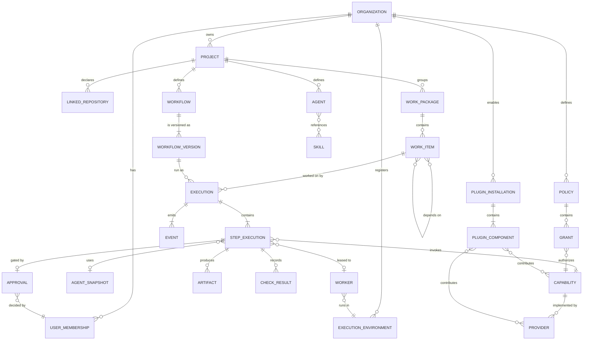
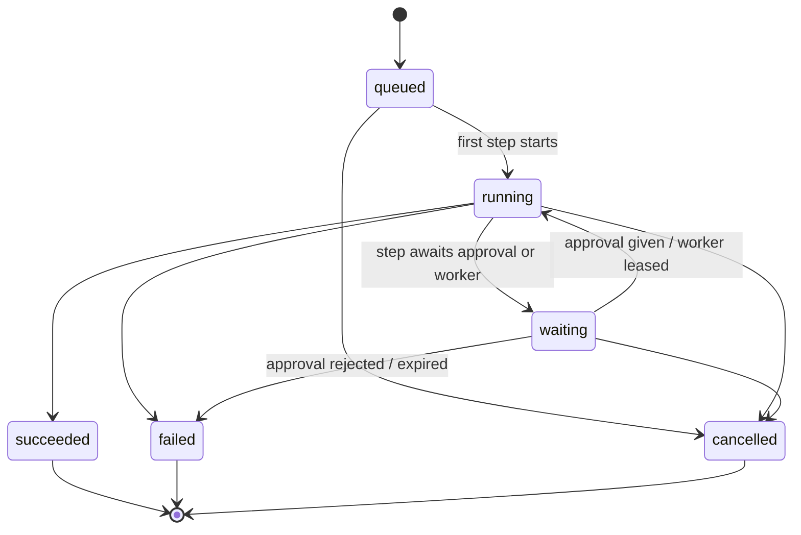
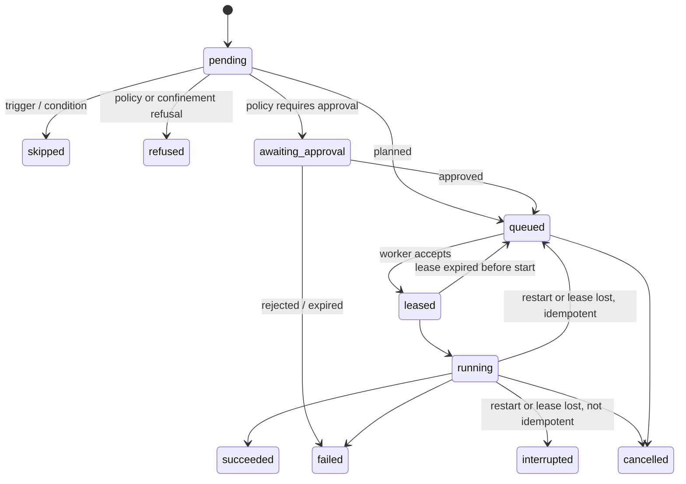

# Conceptual Domain Model

Status: **accepted** (2026-10-25). Conceptual, not a database schema. Labels follow [ARCHITECTURE](ARCHITECTURE.md): **[Prototype]** exists in an earlier internal prototype, **[Proposed]** is new. Terms: [glossary](../product/GLOSSARY.md).

## 1. Principles

1. **Definitions vs runs.** Definitions (Workflow, Agent, Skill, Policy) are versioned; runs (Execution, Step Execution) reference the exact version and keep snapshots. A later edit never rewrites history **[Prototype]**.
2. **Humans own intent; the Platform owns execution state.** Work Item status is human-set; Execution state is Platform-set **[Prototype ADR-004]**.
3. **Knowledge stays in the Project.** Domain objects reference project files by path and hash; they do not copy or own them.
4. **Capabilities, not vendors.** Steps invoke Capabilities; Providers are resolved at run time and recorded.
5. **Not every concept is a persistent entity.** Evidence is a view over Events, Artifacts and snapshots; a Lease is operational state of the coordinator.

## 2. Conceptual diagram

## 3. Entities and responsibilities

| Entity | Responsibility | Scope / owner | Persistence | Status |
|---|---|---|---|---|
| Organization | Owns users, Projects, Policies, Environments, plugins. One implicit Organization in a local Instance. | Instance | Platform store | [Prototype: *Workspace*]; [Proposed] |
| User membership | A user's role in an Organization (Owner, Admin, Maintainer, Contributor, Viewer), optionally narrowed or raised per Project ([ADR-0038](adr/0038-roles-teams-and-separation-of-duties.md)). | Organization | Platform store | [Prototype: `workspace_members`] |
| Project | Identity, root/repository location, trust, settings. | Organization | Platform store + `.amaru/` definitions ([ADR-0043](adr/0043-project-definitions-in-git-teams-and-operational-state-in-platform.md)) | [Prototype] |
| Linked repository | Delivery target with base branch and delivery policy. | Project | Definition (Git-reviewable) | [Prototype ADR-026] |
| Work Package | Goal, status, delivery-loop and quality-gate policy. | Project | Platform store ([ADR-0043](adr/0043-project-definitions-in-git-teams-and-operational-state-in-platform.md)) | [Prototype] |
| Work Item | Intent, human status, owner, dependencies, external issue link. Internal id is a ULID; the display key is `<PROJECTKEY>-<n>`, unique per Instance; references across Instances use the Instance URL + ULID. | Work Package | Platform store ([ADR-0043](adr/0043-project-definitions-in-git-teams-and-operational-state-in-platform.md)) | [Prototype] |
| Workflow / Workflow version | Graph of Steps, edges, variables; versions are the Git history of `.amaru/`; each Execution stores the commit SHA, content hash and an immutable snapshot of the version it ran. | Project | Definition (YAML) + snapshot in run history | [Prototype]; versioning [Proposed] |
| Agent / Agent snapshot | Instructions, model and provider preference, Skills, tool scope; the snapshot is what a Step used. | Organization or Project ([ADR-0039](adr/0039-configuration-scopes-and-resolution-order.md); the Organization library UI is FEAT-AGT-006, P2) | Definition (Project) or Platform store (Organization); snapshot in run history | [Prototype] |
| Skill | Trusted procedural knowledge with hash. | Organization or Project | Read from the Project (Project Skills) or the Platform store (Organization Skills) | [Prototype] |
| Team | Members (humans, Agents) with team roles; referenced by slug from definitions and gates. | Organization | Platform store ([ADR-0043](adr/0043-project-definitions-in-git-teams-and-operational-state-in-platform.md), [ADR-0038](adr/0038-roles-teams-and-separation-of-duties.md)) | [Prototype ADR-019] |
| Capability | Typed spec (inputs, outputs). | Catalog (built-in or contributed) | Catalog | [Prototype] |
| Provider | Implementation of Capabilities, with availability per Environment. | Environment / plugin | Registry | [Prototype] |
| Execution | A run of a Workflow version (or a single Step) for an optional Work Item; lifecycle; trigger; requesting identity. | Project | Run history | [Prototype] |
| Step Execution | State, resolved Agent, inputs, outputs, verdict, approval state, usage, external job reference, assigned Worker. | Execution | Run history | [Prototype] |
| Event | Immutable fact with a Platform-assigned per-Execution `seq` (Evidence is ordered by `seq`, never by Worker clocks) and a stream cursor. | Project / Execution | Event log | [Prototype] |
| Artifact | Path or object key, role, hash, size, producing Step. | Step Execution | Artifact store | [Prototype] |
| Check result | Local Check, CI or Verification Run outcome bound to a commit or Artifact. | Step Execution / Work Item | Run history | [Prototype ADR-029]; [Prototype: VerificationRun] |
| Approval | Request and decision, approver identity, Evidence references, expiry. | Step Execution | Run history | [Prototype: approval steps]; evidence binding [Prototype] |
| Policy / Grant | Rules and standing authorizations for Capabilities, egress, plugins. | Organization / Project | Platform store | [Prototype: grants ADR-024]; general Policy [Proposed] |
| Execution Environment | A machine or sandbox class with OS, tools, labels, trust level. | Organization | Platform store | [Proposed] |
| Worker | A connected process in an Environment with identity, manifest, health. | Execution Environment | Operational state | [Proposed] |
| Plugin installation / component | Installed package version, granted permissions, enabled components per target. | Organization (the implicit Organization in a local Instance; [ADR-0021](adr/0021-plugin-packaging-signing-permissions-and-compatibility.md)) | Platform store | [Proposed] |
| Delivery-loop ledger | Per Work Item: phase, attempts, runs, PR, CI, local checks, recoveries. | Work Package | Operational state | [Prototype `domain/autoloop.go`] |

**Not first-class entities:** *Evidence* (a query over Events, snapshots, Artifacts, check results, Approvals), *Lease* (coordinator state attached to a Step Execution), *Task* (not used; see glossary mapping), *Signal* (P2; would be its own entity when scheduled).

## 4. Key relationships and rules

- A Work Item belongs to exactly one Work Package; dependencies are within a Project (prototype limits them to one Package; Amaru allows any Work Package of the same Project, never across Projects; see [§7](#7-resolved-domain-questions)).
- An Execution runs exactly one Workflow version; resume after restart requires the same version **[Prototype `ResumeInterrupted`]**.
- A Step Execution has at most one active Lease and at most one Approval at a time.
- An Approval references the Evidence presented: commit SHA, diff Artifact, check results. If the subject changes (new commit) while the Approval is `requested`, it is voided and re-requested; a decided Approval is never edited and does not authorize the action when the evidence digest has changed ([ADR-0048](adr/0048-approval-reuse-uncovered-capabilities-and-policy-defaults.md)) **[Proposed]**.
- Grants authorize Capabilities for subjects (Agent, Workflow, Plugin component) in a scope (Organization, Project); Approvals authorize one occurrence (ADR-0006).
- Providers are resolved per Step from the Agent's preference, Policy and the Environments that advertise the Capability.

## 5. Lifecycles

### 5.1 Execution

The prototype has `queued, running, succeeded, failed, cancelled` with a pending approval keeping the step `running` (`domain/execution.go`). Amaru adds an explicit `waiting` state so clients and schedulers can distinguish idle waits **[Proposed]**.

### 5.2 Step Execution

Prototype states: `queued, running, succeeded, failed, cancelled, skipped, unsupported` plus `runtime_restarted` as an error code (`domain/step.go`). `refused`, `leased`, `awaiting_approval` and `interrupted` are **[Proposed]**; `unsupported` becomes `refused` with a reason. A Worker lost mid-Step follows the restart rule of [ADR-0042](adr/0042-durable-execution-with-explicit-restart-semantics.md) (`interrupted` with reason `worker_lost` unless idempotent), so there is no separate `lost` state. `awaiting_approval` is the one waiting state for both an explicit Approval Step (Step type `approval`) and a Policy-required approval before any other Step starts; nothing runs while a Step is in it.

**Implementation status (2026-10-26):** the Execution and Step state machines of §5.1–5.2 are implemented and unit-tested in `services/platform/internal/domain` ([#118](https://github.com/rluders/amaru/issues/118)); only the transitions drawn above are possible. **Gaps in this section, not decided here:** (a) ADR-0042 says an `interrupted` Step is resumed by a human or a Policy rule, and ADR-0044 adds a `timed_out` ending, but neither has a transition or state in §5.2; the code treats `interrupted` as terminal until they are documented. (b) §5.1 has no edge for an Execution whose Step is `interrupted`.

### 5.3 Work Item
`todo → in_progress → done`, with `blocked` reachable from `todo` and `in_progress` and back. Status is human-set; the delivery loop may move an item only as its Policy allows and records the transition as an Event **[Prototype]**.

### 5.4 Delivery-loop phases (per Work Item)
`waiting → implementing → validating → reviewing → awaiting_ci → awaiting_merge → done`, with `blocked`, `needs_grant` and `paused` reachable from any active phase **[Prototype `AutoloopPhase`]**. Amaru keeps the phases and moves budget rules (attempts, repairs, reviews, restart recoveries) into Policy.

### 5.5 Approval
`requested → approved | rejected | expired | voided` (voided when its subject changes). **[Prototype: pending/approved/rejected]**; `expired` and `voided` **[Proposed]**.

### 5.6 Worker
`registering → idle ⇄ busy → draining → offline`, with `unhealthy` on missed heartbeats **[Proposed]**.

### 5.7 Plugin installation
`installed → enabled ⇄ disabled → removed`, with `incompatible` when the Instance's contract version leaves the plugin's range **[Proposed]**.

## 6. Differences between the predecessor models

| Topic | prototype Runtime | earlier prototype | Amaru choice |
|---|---|---|---|
| Workflow run | Parent Execution with Step Executions | `WorkflowRun` with per-agent `Execution`s and a state-machine workflow (`workflows/state_machine.go`) | Execution + Step Execution; Workflows are graphs, not state machines |
| Workflow shape | DAG of Steps | States and transitions | DAG; explicit approvals are Steps of type `approval`, and Policy can add an approval gate before any Step (both wait in `awaiting_approval`) |
| Tenant | None (single user) | Workspace | Organization |
| Evidence | Context, events, CI log selection | Diff, VerificationRun, Approval links | Union, as a query |
| Agent definition | Rich (tools, MCP, workspace commands) | Agent + Skills + Team | prototype shape plus Team from both |
| Persistence | Files | PostgreSQL | Storage ports; PostgreSQL everywhere ([ADR-0015](adr/0015-postgresql-is-the-only-database-bundled-in-compact-installs.md)) |
| Intake | GitHub issue intake | Signals with triage | Intake now (P1); Signals later (P2) |

## 7. Resolved domain questions

- **Work Item dependencies** may cross Work Packages within one Project; cross-Project dependencies are not supported.
- **Workflow definitions** live in Git under `.amaru/`; operational state, including Work Items, lives in the Platform ([ADR-0043](adr/0043-project-definitions-in-git-teams-and-operational-state-in-platform.md)).
- **Teams** are Organization-scoped Platform state; definitions reference them by slug ([ADR-0043](adr/0043-project-definitions-in-git-teams-and-operational-state-in-platform.md)).
- **Agents** are Organization principals without login; they act only through Executions, never hold credentials or an Organization role, and are attributed to a human sponsor ([ADR-0038](adr/0038-roles-teams-and-separation-of-duties.md)).
- **Agents and Skills** exist at Organization and Project level; a Project definition with the same id overrides the Organization one ([ADR-0039](adr/0039-configuration-scopes-and-resolution-order.md)).
- **Work Item owner** is always a human; Agents and Teams are assignees. Separation of duties is enforced per gate against the initiator and the Agent's human sponsor ([ADR-0036](adr/0036-approvals-bind-to-evidence-and-gate-work.md), [ADR-0038](adr/0038-roles-teams-and-separation-of-duties.md)).
- **Execution Environments** belong to exactly one Organization. Vendor-run Cloud pools are vendor-owned and leased to one Organization at a time; customer-run Workers are never shared across Organizations ([ADR-0022](adr/0022-cloud-tenancy-row-level-isolation-by-organization.md)).
- **Knowledge references** from Work Items and Steps are path + section + content hash at a commit, resolved by path at the recorded commit; once the Knowledge index ships (FEAT-PRJ-007, P2) search and reference suggestions go through it ([ADR-0030](adr/0030-knowledge-is-lexically-indexed-project-documentation.md)).
