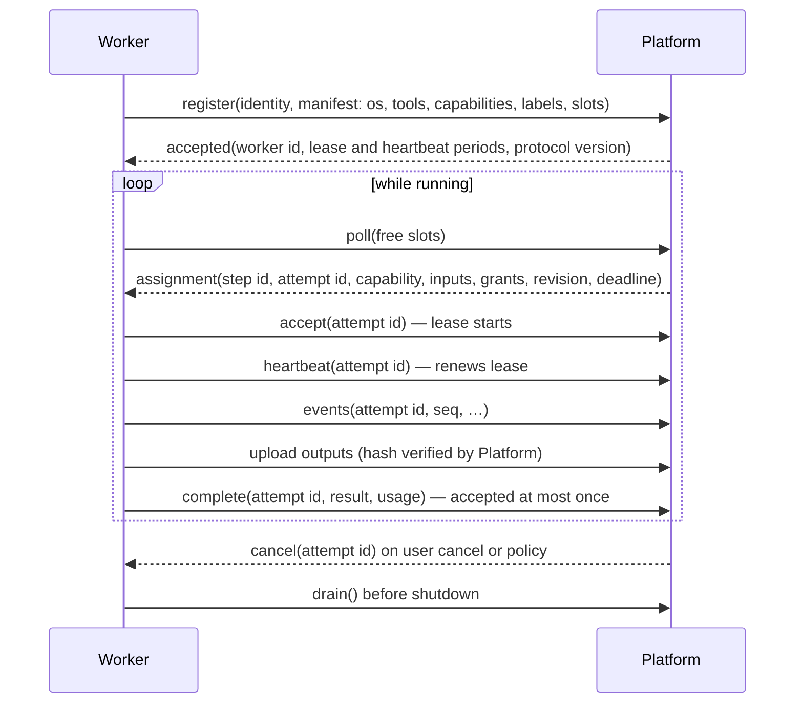
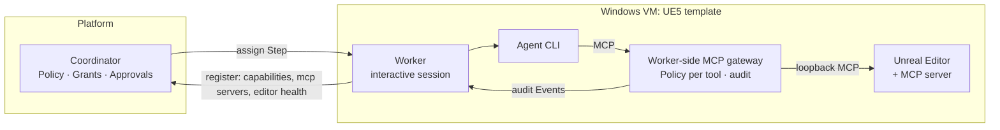

# Execution Environments and Workers

Status: **accepted** (2026-10-25). Nothing here is built in any repository. Extends [ARCHITECTURE §4](ARCHITECTURE.md#4-platform-and-worker-boundary) and [§14](ARCHITECTURE.md#14-remote-execution-environments). Decisions: [ADR-0009](adr/0009-modular-monolith-platform-with-separate-worker-role.md), [ADR-0013](adr/0013-outbound-pull-based-workers-with-leases.md), [ADR-0024](adr/0024-remote-worker-registration-identity-and-delivery.md), [ADR-0029](adr/0029-worker-protocol-over-websocket-and-protobuf.md), [ADR-0035](adr/0035-agents-run-beside-environment-hosted-tools.md). Features: FEAT-ENV-* in the [catalog](../product/FEATURE_CATALOG.md#29-execution-environments-and-workers-env).

## 1. Separation of roles

- The **Platform coordinates**: what should run, where, under which Policy; it records outcomes.
- **Workers execute**: they run one Step at a time per slot through Providers, inside an **Execution Environment**, and report Events, outputs and usage. They hold no authoritative domain state.
- Environments differ in OS, tools, hardware, licenses, network and trust. The Platform must not assume uniformity.

## 2. Examples

| Environment | OS | Typical Capabilities | Constraints |
|---|---|---|---|
| Engineer laptop (embedded Worker) | Any | `agent.run`, `code.test`, local checks | Intermittently online; user's credentials |
| Linux build worker | Linux | `code.test`, `code.build`, `agent.run` | Headless; shared |
| Container sandbox | Linux | `agent.run`, verification runs | Rootless, single-level containers; network policy |
| Windows VM with Unreal Engine 5 + MCP | Windows | `engine.build`, `engine.test`, `asset.import`, MCP tools exposed by the editor | Interactive session with the editor running; long builds; licensed software; GPU |
| Blender / GPU machine | Linux or Windows | `mesh.*`, `render.*` | GPU scheduling; large outputs |
| Managed Cloud worker | Linux | `agent.run`, `code.test` | Tenant isolation; no access to customer networks |

## 3. Worker lifecycle and protocol (draft)

| Concern | Rule |
|---|---|
| Connection | Outbound from the Worker. TLS. Enrollment token → Ed25519 key identity ([ADR-0024](adr/0024-remote-worker-registration-identity-and-delivery.md)). Transport: Protobuf over WebSocket ([ADR-0029](adr/0029-worker-protocol-over-websocket-and-protobuf.md)). |
| Capability manifest | OS, architecture, tools with versions, Capabilities, labels, concurrency slots, sandbox support. Changes trigger re-registration. |
| Health | Heartbeats per Worker and per lease. Missed heartbeats mark the Worker `unhealthy`, then `offline`. |
| Dispatch | Pull-based. The Platform matches required Capability, labels, Policy and data locality. Without an eligible Worker, the Step is `queued` with the reason shown. |
| Leases | Per attempt. Heartbeat 10 s, Lease 30 s by default. On expiry the Step is retried as a new Lease if its Capability is declared idempotent, otherwise it ends `interrupted` (`worker_lost`) for a human or Policy decision ([ADR-0042](adr/0042-durable-execution-with-explicit-restart-semantics.md), [resilience](RESILIENCE.md)). |
| Revision | The assignment names the repository and commit. The Worker fetches it with credentials scoped to that repository. No shared filesystem is assumed. |
| Secrets | Delivered per assignment, scoped to the Capability and Step, never persisted by the Worker beyond the Step; redacted from Events. |
| Artifacts | Uploaded to the Platform's artifact store with hashes. Large outputs use resumable chunked HTTP uploads or presigned S3 URLs ([ADR-0017](adr/0017-content-addressed-artifact-store-filesystem-or-s3.md)). |
| Cancellation | Cancel messages and lease revocation; the Worker terminates the process tree (Weave `platform` package precedent; Windows uses Job Objects, validated in the M5 spike — Weave GAP-05 never validated it). |
| Disconnection | Running Steps continue for the lease period. On reconnect the Worker reports progress. Duplicate completions are ignored by attempt ID. |
| Authorization | A Worker may run only Capabilities its Environment's Policy allows. Consequential Capabilities still need Platform-side Grants or Approvals before assignment. |
| Upgrade | Workers report their version; the Platform refuses assignments to incompatible Workers (NFR-29). |

## 4. Environment-hosted tools and MCP

Some tools only exist inside a running application on the Environment. The reference case is an **Unreal Engine 5 VM** with an MCP server inside the Unreal Editor (FEAT-ENV-009, FEAT-ENV-013).

- The Worker manifest lists **MCP servers** with their tools, next to Capabilities. They are discovered from configuration or from plugin `worker-adapter` components.
- **The agent runs on the Worker beside the tools** ([ADR-0035](adr/0035-agents-run-beside-environment-hosted-tools.md)). Low latency, and MCP traffic stays on the VM. Agent credentials reach the VM for that Lease only.
- The Worker runs the **MCP gateway** (the Weave ADR-025 design, moved to the Worker). Every tool call is Policy-checked per tool and audited as an Event; the agent reaches the editor's MCP server only through it.
- There is no Platform-side MCP gateway and no remote agent placement. Epic's Unreal MCP plugin (UE 5.8, experimental) listens on loopback only, without authentication, which rules out remote access anyway.
- Consequential editor actions (saving assets, source-control submits) are Capabilities subject to Grants or Approvals.
- **MCP server choice** (FEAT-ENV-009): the Environment template uses Epic's Unreal MCP plugin for engine versions that ship it (UE 5.8+). A community MCP server is supported only for older engine versions; it goes through the same gateway and Policy.
- **Session and editor health** (FEAT-ENV-011): the Worker runs in the interactive session, reports whether the editor is running, responsive and has the right project loaded, starts or attaches to the editor before a Step, and refuses Steps when unhealthy.

## 5. Provisioning and lifecycle (FEAT-ENV-014, M7)

| Concept | Rule |
|---|---|
| Environment template | Declares image or base VM, installed tools (e.g. UE 5.x + MCP plugin + project checkout), Capabilities, labels, cost class, license-seat limit, idle timeout. |
| Start on demand | When a queued Step needs a label no running Worker offers, the Platform asks a provisioner to start an Environment from the template. The Step waits as `queued` with the reason shown. |
| Idle stop | Environments stop after the template's idle timeout. Long-lived Environments opt out. |
| Reset | Optional reset to a snapshot before or after a run, for clean state. |
| Provisioners | Plugin `service` components behind one versioned provisioner contract, `amaru.provisioner/v1` (create from template, start, health, snapshot-reset, stop, destroy), following [ADR-0025](adr/0025-api-and-protocol-versioning-policy.md). The first first-party provisioner is Proxmox VE (M7); libvirt, Hyper-V and cloud VM APIs follow as plugins on demand. Pre-existing machines need no provisioner and simply register. |
| Accounting | Start, stop and runtime are Events, attributed to the Work Item that caused them (FEAT-OBS-004). |

## 6. Embedded Worker

In compact mode the Worker runs inside the Platform process (Weave's model) but uses the same assignment, lease and completion interfaces in memory. The test suite runs assignment scenarios against both the embedded and a separate Worker, to keep the remote path honest (ADR-0009).

## 7. Sandboxing

- **Local processes:** argv arrays, explicit cwd, environment allowlist, prompts via stdin, process groups. Claude Code's OS sandbox is used for workspace commands where available **[Weave]**.
- **Container sandbox Environment:** single-level rootless containers with dropped capabilities and resource limits. This follows the Weave prototype's `PodmanRuntime.Run` flags. Its investigation shows nested rootless containers inside a container fail (`newuidmap`), so the sandbox Worker runs on the host or VM, never nested (`weave` `INVESTIGATION.md`, `INVESTIGATION-EXECUTION-BOUNDARY.md`).
- **Environment sandbox class** ([ADR-0041](adr/0041-isolation-tiers-for-plugins-providers-and-steps.md)) is set by an Owner or Admin: `container` (default for server and Cloud Environments; one rootless container per Lease) or `none` (default for workstations and the compact embedded Worker). Policy can require `container` for a Capability.
- **Local Checks:** currently unsandboxed in Weave (documented residual risk). Sandboxed in a `container`-class Environment (FEAT-VAL-004).

## 8. Remote development environments

A remote development machine is an Execution Environment with a long-lived Worker and labels such as `dev:<user>`. Interactive use (an engineer attaching an IDE) is outside Amaru; Amaru coordinates Steps on it. Interactive desktop-session tools (the Unreal Editor, Blender UI) need the Worker to run inside the user session; that is FEAT-ENV-011 (P1, M5), see [§4](#4-environment-hosted-tools-and-mcp).

## 9. Resolved points

- **Transport**: Amaru's own protocol, Protobuf over WebSocket ([ADR-0029](adr/0029-worker-protocol-over-websocket-and-protobuf.md)); no durable engine's worker model is used ([ADR-0042](adr/0042-durable-execution-with-explicit-restart-semantics.md)). Assignments reach the Worker gateway through NATS work queues ([ADR-0016](adr/0016-nats-jetstream-message-bus-embedded-in-compact-installs.md)).
- **Non-Git inputs** (large binary assets): delivered as content-addressed bundles from the Artifact store and cached on the Worker by hash ([ADR-0017](adr/0017-content-addressed-artifact-store-filesystem-or-s3.md), [ADR-0024](adr/0024-remote-worker-registration-identity-and-delivery.md)). Git LFS content comes through the Git checkout.
- **Worker auto-scaling** (Cloud and distributed self-hosted, M9): pools scale on the number of queued assignments per pool and idle timeouts from the Environment template; manual registration stays the default elsewhere.
- **Per-Environment cost** (GPU time): Usage records carry Environment id and cost class, priced from the Environment template ([ADR-0033](adr/0033-usage-and-cost-telemetry-model.md)).
- **Agent placement**: on the Worker beside the tools ([ADR-0035](adr/0035-agents-run-beside-environment-hosted-tools.md)).
- **Engine and OS license activation** on provisioned VMs: part of the Environment template, owned by the operator; license keys are Secrets delivered to the Lease, never baked into images or stored in definitions.
- **Several agents and one editor**: editor-bound Environments are leased exclusively, one Step at a time per editor instance ([ADR-0035](adr/0035-agents-run-beside-environment-hosted-tools.md)); parallelism comes from more Environments.
