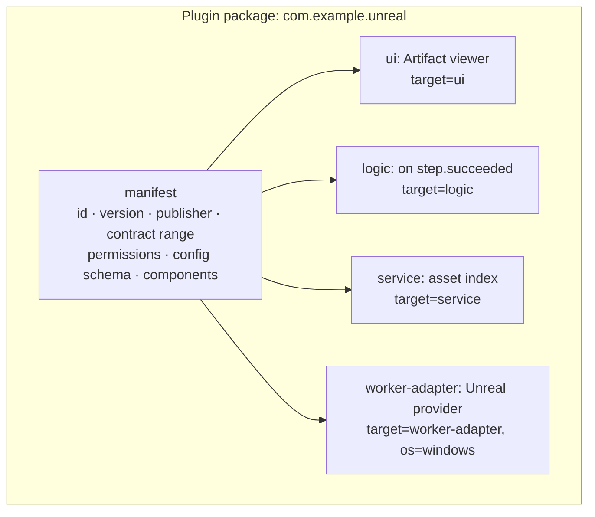

# Plugin and Extension Architecture

Status: **accepted** (2026-10-25). Nothing here is built. Extends [ARCHITECTURE §6](ARCHITECTURE.md#6-plugin-and-extension-model), [ADR-0005](adr/0005-plugin-extensibility-independent-of-desktop.md) and [ADR-0012](adr/0012-plugin-package-with-targeted-components.md) plus [ADR-0041](adr/0041-isolation-tiers-for-plugins-providers-and-steps.md), [ADR-0040](adr/0040-plugin-logic-runs-in-a-separate-plugin-host-process-built-with-javy.md) and [ADR-0021](adr/0021-plugin-packaging-signing-permissions-and-compatibility.md). Features: FEAT-PLG-* in the [catalog](../product/FEATURE_CATALOG.md#216-plugins-plg).

## 1. Goals

- **TypeScript** is the main language for third-party extensions. Rust is never required for an ordinary extension.
- One extension can contribute UI, logic, services and environment adapters, and still install as one unit.
- An extension never runs with more authority than it declared and the user granted.
- Portable and environment-specific parts are distinguished explicitly. A plugin must not assume Cloud can read a laptop, or that Desktop is online.

## 2. Evidence from predecessors

- **[Weave]** External Providers:
  - executables installed per user under `<stateDir>/providers/<id>/provider.yaml`
  - speak the stdio protocol `weave.provider/v1` (`protocol/provider.schema.json`)
  - argv only, with an allowlisted environment
  - never installed per Project
- **[Weave]** MCP:
  - servers configured per user (ADR-016)
  - an audited MCP gateway was designed but not built (ADR-025)
- **[Weave]** Grants:
  - user-level, hash-bound grants (ADR-024)
  - Skills trusted by content hash (ADR-011/017)
- **[Prototype]** Capability gateway: an allowlist-based gateway with an `Adapter` interface (`capability/gateway.go`), whose only adapter is `github.pull_request`.
- **Not in either:** UI extensions, a plugin manifest, a TypeScript SDK, sandboxed logic, a registry.

## 3. Extension forms and trust

| Form | Where it runs | Trust tier | Who may ship it | Typical use |
|---|---|---|---|---|
| **In-process module** | Inside the Platform or Desktop host | Full | First party only | Core Capabilities, storage adapters, Tauri framework plugins |
| **Local process** | Child process of a Worker or the Platform, argv + env allowlist | Granted permissions only | Anyone | Providers, local adapters (Weave model) |
| **Sandboxed logic** | Extension host (JS runtime without ambient I/O) | Granted API surface only | Anyone | Event reactions, automation, Capability handlers in TypeScript |
| **UI extension** | Isolated frame in Web/Desktop | Public API via SDK bridge, granted scopes | Anyone | Panels, pages, Artifact viewers, Step forms |
| **Self-hosted service** | Separate process/container next to the Platform, machine identity | Declared events and API scopes | Anyone, deployed by an operator | Integrations needing their own dependencies; Environment provisioners (FEAT-ENV-014) |
| **Cloud-managed service** | Vendor-operated isolation | Vendor-reviewed | Reviewed publishers | Cloud integrations |
| **External connector** | A third-party service called over its API | Egress grant + secrets | Anyone (as configuration) | SaaS integrations |

Deployment and trust semantics differ per row on purpose. The same plugin can have components in several rows.

## 4. Package model

Manifest fields (draft, becomes a contract schema with fixtures in M6):

| Field | Meaning |
|---|---|
| `id`, `version`, `publisher` | Identity. Reverse-DNS ID; SemVer. |
| `contracts` | Compatible contract range (e.g. `api: ^1`, `provider: ^1`). |
| `permissions` | Requested scopes: API resources (read/write), events, Capabilities provided or invoked, egress hosts, secrets keys, filesystem roots (local adapters only). |
| `config` | JSON Schema for settings. Secrets are marked and stored through the secrets port. |
| `components[]` | Each has `name`, `target` (`ui`, `logic`, `service`, `worker-adapter`, `local-adapter`), `entry`, `availability` (deployments, OS, online requirement), `required` (bool). |
| `contributes` | Declarative contributions: UI slots, commands, Capability specs, Step types, event subscriptions. |

**Rules**
- A component is enabled only where its target exists and its permissions are granted. The UI shows which components are inactive and why.
- A plugin is *usable* if all `required` components are enabled.
- Capabilities contributed by a plugin are catalog entries, never new core interfaces (Weave rule).
- Permission growth on update requires new consent.

## 5. Execution models per target

| Target | Host | Isolation | API access | Status |
|---|---|---|---|---|
| `ui` | Web/Desktop UI extension host | Sandboxed iframe (no same-origin), CSP, message-RPC bridge | SDK over the bridge, with the user's session limited to the granted scopes | [Proposed] |
| `logic` | `amaru plugin-host` process (one per Organization, supervised by the Platform) | TypeScript compiled with Javy + the Amaru Javy plugin to a QuickJS Wasm module with no WASI imports, run by wazero; only Amaru host calls; memory cap, CPU deadline and call quota ([ADR-0040](adr/0040-plugin-logic-runs-in-a-separate-plugin-host-process-built-with-javy.md)). | Host functions mapped to SDK calls | [Proposed] |
| `service` | Operator-deployed process/container | OS/container isolation, machine identity | Public API + event subscription with scoped token | [Proposed] |
| `worker-adapter` | Worker | Child process, argv + env allowlist (Weave model); inside a per-Lease container when the Environment's sandbox class is `container` ([ADR-0041](adr/0041-isolation-tiers-for-plugins-providers-and-steps.md)) | Provider protocol | [Weave] precedent |
| `local-adapter` | Worker on a user's machine (embedded or Desktop-supervised) | Child process; declared filesystem roots | Provider protocol | [Proposed] |

TypeScript code never executes inside the privileged Desktop host or the Go Platform process.

## 6. Native extensions

- **Framework-level native plugins** (e.g. Tauri plugins for notifications, keychain, updater) are first-party parts of the Desktop host. They are not Amaru plugins and are not distributed by the registry.
- **Amaru-level native extensions** for third parties are out of scope (FEAT-PLG-012). Native needs are met by `local-adapter` or `worker-adapter` processes written in any language, including Rust or Go, speaking the provider protocol.

## 7. Lifecycle

| Stage | Behavior |
|---|---|
| Install | Verify integrity and the cosign signature against the Organization's trust list; unsigned only in developer mode ([ADR-0021](adr/0021-plugin-packaging-signing-permissions-and-compatibility.md)). Check the compatibility range. Show permissions. Record an Event. |
| Enable | Grant permissions (Grants), validate configuration, start component hosts. |
| Update | Stage the new version, show new permissions, swap atomically, roll back on start failure. |
| Disable / remove | Stop components and revoke grants. Configuration is retained or deleted as the user chooses. History stays. |
| Failure | A crashing component is restarted with backoff and then disabled with a visible reason. It never takes down the Platform or a client. |

## 8. Portability matrix

| Component target | Local compact | Self-hosted server | Cloud | Web client | Desktop client | Offline Desktop |
|---|---|---|---|---|---|---|
| `ui` | ✓ (Web) | ✓ | ✓ | ✓ | ✓ | ✓ if the Instance is local |
| `logic` | ✓ | ✓ | ✓ (vendor host) | — | — | ✓ if the Instance is local |
| `service` | optional | ✓ | reviewed only | — | — | — |
| `worker-adapter` | ✓ (embedded Worker) | ✓ | ✓ (managed or customer Workers) | — | — | ✓ |
| `local-adapter` | ✓ | via a user-run Worker | via a customer-run Worker | — | — | ✓ |

Rule: a component that needs a user's machine is always a `local-adapter` reached through a Worker the user runs. Cloud never reads a laptop directly.

## 9. Distribution and registry (decided, built at M10)

The decisions that guide a future registry without building it now:
- **Package format:** a deterministic `.tar.zst` archive containing the manifest and component bundles, signed with cosign and content-addressed ([ADR-0021](adr/0021-plugin-packaging-signing-permissions-and-compatibility.md)).
- **Identity and provenance:** cosign signatures, keyless for public publishers, own keys or private PKI for self-hosted, verifiable offline; packages distributed as OCI artifacts ([ADR-0021](adr/0021-plugin-packaging-signing-permissions-and-compatibility.md)). Build provenance recorded when available.
- **Versioning:**
  - SemVer.
  - Dependency resolution is limited to contract ranges. Plugins do not depend on other plugins in v1.
- **Review and trust:** registry-level review tiers (unreviewed, verified publisher, vendor-reviewed). Cloud allows only reviewed `service` components.
- **Commercial plugins:** license metadata in the manifest. Enforcement is out of scope until Cloud billing exists (FEAT-PLG-011).
- **Self-hosted:** offline installation from a file and private registries.

## 10. Resolved points

- **Sandboxes**: `logic` as Javy-built QuickJS Wasm on wazero in the separate plugin-host process ([ADR-0040](adr/0040-plugin-logic-runs-in-a-separate-plugin-host-process-built-with-javy.md)); local adapter processes rely on process isolation plus Policy, with Linux Landlock where available and no OS sandbox requirement on Windows or macOS ([ADR-0041](adr/0041-isolation-tiers-for-plugins-providers-and-steps.md)).
- **UI extensions in v1** contribute to declared **slots** only (panels, actions, Work Item tabs, settings sections); whole pages are not supported in v1.
- **Event delivery** to `logic` and `service` components is at-least-once with an idempotency key per Event; components must deduplicate ([ADR-0016](adr/0016-nats-jetstream-message-bus-embedded-in-compact-installs.md)).
