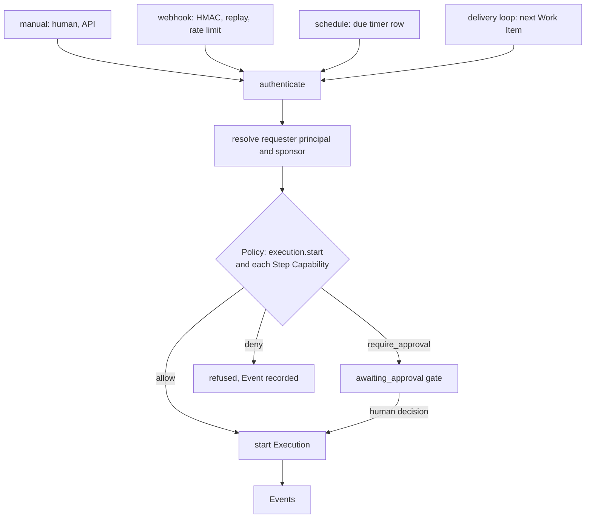

# Policy, Approval, roles and configuration shapes

Status: **Proposed** (WP-M1-04, [#5](https://github.com/rluders/amaru/issues/5)). A design draft of contract shapes for M2. **Nothing here is implemented** and none of the YAML or JSON below is a published contract: the M2 contracts ([WP-M2-01](WORK_PACKAGES.md#wp-m2-01-contracts-package-from-the-prototype-protocol)) own the final form, and a shape changes there only through review. Decisions are the accepted ADRs; this document adds no decision. Where it had to choose between readings, it says so and records a [proposed question](OPEN_QUESTIONS.md#q56-what-happens-to-a-decided-approval-and-to-a-retried-step-when-evidence-changes).

Source ADRs: [0036](adr/0036-approvals-bind-to-evidence-and-gate-work.md) (Approvals), [0037](adr/0037-one-policy-evaluates-capabilities-grants-and-approvals.md) (Policy), [0038](adr/0038-roles-teams-and-separation-of-duties.md) (roles and Teams), [0039](adr/0039-configuration-scopes-and-resolution-order.md) (configuration), [0042](adr/0042-durable-execution-with-explicit-restart-semantics.md) and [0044](adr/0044-restart-semantics-clarifications-from-the-m1-spike.md) (restart semantics, `idempotent`), [0043](adr/0043-project-definitions-in-git-teams-and-operational-state-in-platform.md) (what lives in Git), [0006](adr/0006-human-authorization-for-consequential-actions.md) (human authorization). Rule: [SECURITY_MODEL rule 12](../security/SECURITY_MODEL.md#baseline-rules).

## 1. Conventions

- Every document shape carries `schemaVersion: 1` (integer major; additive changes only within a major; loaders refuse unknown future majors, [AMARU_DIRECTORY §4](AMARU_DIRECTORY.md)). Shapes are written as YAML for definitions and JSON for API and Event payloads; both are the same model.
- Ids are ULIDs. Hashes are `sha256:<hex>`. Times are RFC 3339 UTC.
- **Examples contain no secrets.** Secrets appear only as names (`secretRef`); values never occur in configuration, Events, Approvals or Evidence ([baseline rule 4](../security/SECURITY_MODEL.md#baseline-rules), [ADR-0039](adr/0039-configuration-scopes-and-resolution-order.md)).
- Capability ids in tables are **proposed names** for the catalog; only `agent.run`, `check.run` and `git.push` appear elsewhere in the planning documents ([ARCHITECTURE](ARCHITECTURE.md)). Naming is a catalog decision in M2.
- Status labels follow the [vocabulary](../engineering/CONVENTIONS.md#status-vocabulary): everything below is **Proposed**; accepted ADRs are decisions, not implementation.

## 2. Principals and roles

A **principal** is whoever or whatever a request is attributed to ([ADR-0038](adr/0038-roles-teams-and-separation-of-duties.md), [DOMAIN_MODEL §7](DOMAIN_MODEL.md#7-resolved-domain-questions)).

```yaml
schemaVersion: 1
# Principal as it appears in a Policy request, an Approval and an Event
kind: human            # human | agent | trigger | plugin
id: 01J9ZPRINCIPAL0000000000001
displayName: Ada Example
organizationRole: maintainer      # humans only
projectRole: null                 # optional narrowing or raising for this Project
sponsor: null                     # agent and trigger: the human accountable for it
teams: [reviewers]                # slugs; humans and agents
```

| Field | Rule |
|---|---|
| `kind: human` | The only kind that may decide an Approval. Holds exactly one Organization role and optionally one Project role. |
| `kind: agent` | Attribution only. Never holds a role, a credential or the right to approve. `sponsor` is required: the human on whose Execution it ran. |
| `kind: trigger` | A webhook, schedule or delivery-loop Trigger acting as the requester of an Execution. Never approves. `sponsor` is the human who created or last edited the Trigger. See §7 and [Q57](OPEN_QUESTIONS.md#q57-how-does-policy-treat-a-capability-no-rule-covers-and-who-is-the-requester-of-a-triggered-execution). |
| `kind: plugin` | A plugin component acting through the Policy-checked plugin API. Never approves. |

### 2.1 Role matrix (fixed set, no custom roles)

| Action | Owner | Admin | Maintainer | Contributor | Viewer |
|---|---|---|---|---|---|
| Read Projects, Work Items, Executions, Evidence | yes | yes | yes | yes | yes |
| Create Work Items, start Executions | yes | yes | yes | yes | no |
| Decide an Approval (when also meeting the gate's SoD and Team rules) | yes | yes | yes | no | no |
| Manage definitions (Workflows, Agents, gates) | yes | yes | yes | no | no |
| Create or revoke Grants, lower a rule-12 default | yes | yes | no | no | no |
| Manage membership, Teams, Workers, plugins, Organization settings | yes | yes | no | no | no |

Source: ADR-0038 (Owner/Admin: membership, Grants, Workers, plugins, settings; Maintainer: approve gates, manage definitions; Contributor: create Work Items, start Executions; Viewer: read) and rule 12 (only Owner or Admin lower defaults, by Grant). Whether Owner and Admin differ is not stated in the ADR; this table treats them alike. A Project-level role may raise or narrow the cell for that Project only.

### 2.2 Team (Organization scope, Platform state)

Teams are never in Git; definitions reference them by slug ([ADR-0043](adr/0043-project-definitions-in-git-teams-and-operational-state-in-platform.md)).

```json
{
  "schemaVersion": 1,
  "slug": "reviewers",
  "name": "Reviewers",
  "members": [
    { "kind": "human", "id": "01J9ZPRINCIPAL0000000000001", "teamRole": "reviewer" },
    { "kind": "agent", "id": "01J9ZAGENT00000000000000001", "teamRole": "implementer" }
  ]
}
```

| Field | Rule |
|---|---|
| `slug` | Unique per Organization; referenced from definitions. Rename and delete behavior is open ([Q55](OPEN_QUESTIONS.md#q55-project-key-and-linked-repository-placement)). |
| `members[].teamRole` | Free label (implementer, reviewer) used by Workflows and gates; carries no permission by itself. |
| Authority | A gate that names a Team accepts only a **human** member of it who also holds a role permitted to decide ([§3.4](#34-separation-of-duties-and-team-rules)). An Agent in a Team never approves. |

## 3. Approval record and Evidence binding

An Approval is a human decision bound to specific Evidence ([ADR-0036](adr/0036-approvals-bind-to-evidence-and-gate-work.md)). Evidence is a **view** over Events, Artifacts, snapshots and check results, not an entity ([DOMAIN_MODEL §1](DOMAIN_MODEL.md#1-principles)); an Approval stores **references and hashes** into that view.

### 3.1 Shape

```json
{
  "schemaVersion": 1,
  "id": "01J9ZAPPROVAL0000000000001",
  "organizationId": "01J9ZORG00000000000000001",
  "projectId": "01J9ZPROJECT00000000000001",
  "state": "approved",
  "gate": {
    "kind": "step_approval",
    "stepExecutionId": "01J9ZSTEPEXEC00000000001",
    "workItemId": "01J9ZWORKITEM0000000001",
    "capability": "scm.pr.create",
    "policyEvaluationId": "01J9ZPOLEVAL0000000000001"
  },
  "requester": { "kind": "human", "id": "01J9ZPRINCIPAL0000000000002" },
  "requirement": {
    "minRole": "maintainer",
    "requiredTeam": "reviewers",
    "separationOfDuties": {
      "enabled": true,
      "differFrom": ["initiator", "agentSponsor"]
    },
    "expiresAt": "2026-11-02T09:00:00Z"
  },
  "evidence": {
    "digest": "sha256:<digest-of-the-canonical-evidence-list>",
    "items": [
      { "kind": "execution", "id": "01J9ZEXEC0000000000000001" },
      { "kind": "step_execution", "id": "01J9ZSTEPEXEC00000000001" },
      { "kind": "commit", "sha": "<commit-sha>", "repository": "origin" },
      { "kind": "diff", "hash": "sha256:<diff-hash>" },
      { "kind": "artifact", "id": "01J9ZARTIFACT00000000001", "hash": "sha256:<artifact-hash>" },
      { "kind": "check_result", "id": "01J9ZCHECK0000000000001", "hash": "sha256:<result-hash>", "outcome": "passed" },
      { "kind": "definition", "commit": "<commit-sha>", "contentHash": "sha256:<definition-hash>", "dirty": false }
    ]
  },
  "decision": {
    "outcome": "approved",
    "approver": { "kind": "human", "id": "01J9ZPRINCIPAL0000000000001" },
    "rationale": "Diff reviewed; checks green.",
    "decidedAt": "2026-10-28T09:12:44Z"
  },
  "requestedAt": "2026-10-28T08:40:02Z",
  "replaces": null,
  "voidedBy": null
}
```

| Field | Meaning |
|---|---|
| `state` | `requested`, `approved`, `rejected`, `expired`, `voided` ([DOMAIN_MODEL §5.5](DOMAIN_MODEL.md#55-approval)). `approved` and `rejected` are terminal and immutable. |
| `gate.kind` | `step_approval` (an Approval Step), `policy_required` (Policy returned `require_approval` before any other Step), or `work_item_acceptance` (Work Item moved to accepted when its Work Package Policy demands it). All three wait in `awaiting_approval` except acceptance, which blocks the Work Item status change. |
| `gate.capability` | Present for `policy_required`: the Capability whose request produced it. |
| `requirement` | Copied from the Policy output ([§4.2](#42-output)) at request time, so a later configuration change does not rewrite what the approver was asked to satisfy. |
| `evidence.items` | The exact Evidence the approver was shown. Kinds in [§3.2](#32-evidence-item-kinds). |
| `evidence.digest` | Hash of the canonical form of `items` (sorted by kind then id; no timestamps). The one value compared at use time. |
| `decision` | Absent while `requested`. `approver` is a human principal; Agents, hooks, triggers and service accounts are rejected by the decision endpoint ([ADR-0036](adr/0036-approvals-bind-to-evidence-and-gate-work.md)). |
| `replaces` / `voidedBy` | Link a re-requested Approval to the one it follows ([§3.3](#33-invalidation)). |

### 3.2 Evidence item kinds

| Kind | Binds | Changes when |
|---|---|---|
| `execution`, `step_execution` | Which run and Step the human judged | Never for a given id; a new run has a new id. |
| `commit` | Commit SHA of the worktree head being delivered | The worktree head moves (new commit, amend, rebase). |
| `diff` | Hash of the diff Artifact against the base | Any change to the delivered content. |
| `artifact` | Artifact id and content hash (version) | A new Artifact version is produced for the same role. |
| `check_result` | Local Check, CI or Verification outcome bound to a commit or Artifact | A re-run produces a different result record, or the commit it checked changed. |
| `definition` | Workflow version commit and content hash (ADR-0043); `dirty` flags uncommitted edits | The Workflow definition resolved for the Execution changes. |

`work_item_acceptance` gates bind, additionally, the Work Item's delivered Artifacts and the approved Step Approvals they rely on.

### 3.3 Invalidation

[ADR-0036](adr/0036-approvals-bind-to-evidence-and-gate-work.md): if bound Evidence changes, **pending** Approvals are invalidated and re-requested; **decided** Approvals stay attached to the Evidence they saw. [DOMAIN_MODEL §4](DOMAIN_MODEL.md#4-key-relationships-and-rules) says the Approval "is void" when its subject changes. These read differently for an already-`approved` record; this draft follows the ADR and checks validity at use time (rule 3 below). The tension is [Q56](OPEN_QUESTIONS.md#q56-what-happens-to-a-decided-approval-and-to-a-retried-step-when-evidence-changes).

| # | Rule |
|---|---|
| 1 | When any item of a `requested` Approval's evidence changes (new commit, new diff, new Artifact version, new check result, changed definition), the Platform sets `state: voided`, records `voidedBy` (the Event that changed the Evidence) and creates a new `requested` Approval with `replaces` pointing at the voided one and the new `evidence`. Approvers see the new evidence; notifications restart. |
| 2 | An `approved` or `rejected` record is never edited or voided. It remains permanently attached to the `digest` it saw (UC-5). |
| 3 | **Use-time check.** Before an action gated by an `approved` Approval starts, the Platform recomputes the digest of the current Evidence. If it differs from `evidence.digest`, the Approval does not authorize the action: the Step returns to `awaiting_approval` with a new `requested` Approval (`replaces` set). An Approval authorizes **one occurrence** ([ADR-0006](adr/0006-human-authorization-for-consequential-actions.md), [DOMAIN_MODEL §4](DOMAIN_MODEL.md#4-key-relationships-and-rules)); a second use of it needs a new Approval. |
| 4 | `expiresAt` passes with no decision: `state: expired`; the gate fails per its policy (Step `failed`, or the Work Item parks) and a new request may be made by a human. |
| 5 | A `rejected` decision fails the gate (`awaiting_approval → failed`, [DOMAIN_MODEL §5.2](DOMAIN_MODEL.md#52-step-execution)); it is not voided by later changes. |
| 6 | Each state change is an Event with the Approval id, previous and new state, and the evidence digests. Approver rationale is stored; no secret may appear in it or in evidence items. |
| 7 | A missing decision parks only the affected Work Item; the delivery loop continues with others ([ADR-0036](adr/0036-approvals-bind-to-evidence-and-gate-work.md)). |

### 3.4 Separation of duties and Team rules

Configured per gate ([ADR-0038](adr/0038-roles-teams-and-separation-of-duties.md)). A decision is accepted only if all hold:

1. The decider is a `human` principal.
2. The decider's effective role (Project role if set, else Organization role) is at least `requirement.minRole` and permits deciding ([§2.1](#21-role-matrix-fixed-set-no-custom-roles)).
3. If `requirement.requiredTeam` is set, the decider is a human member of that Team at decision time (authority is evaluated from Platform membership at decision time, never from a Git file, [AMARU_DIRECTORY](AMARU_DIRECTORY.md)).
4. If `separationOfDuties.enabled`, the decider differs from each principal in `differFrom`: `initiator` (who started the Execution) and `agentSponsor` (the human sponsor of each Agent that produced bound Evidence).
5. **Compact single-user installs** set `separationOfDuties.enabled: false` by default (one human) and the Approval records `"separationOfDuties": {"enabled": false, "reason": "single_user_install"}` so the audit shows it was disabled, not forgotten.

Rejected decision attempts (wrong role, not in Team, SoD violation, non-human) are recorded as Events and return a typed error; they do not change the Approval.

## 4. Policy evaluation

One pure function checks every action that uses a Capability or resource ([ADR-0037](adr/0037-one-policy-evaluates-capabilities-grants-and-approvals.md)): `(principal, capability, resource scope, context) → allow | require_approval | deny`, with reasons. Domain code, no I/O; it receives its inputs fully resolved.

### 4.1 Input

```json
{
  "schemaVersion": 1,
  "requestId": "01J9ZPOLREQ00000000000001",
  "principal": { "kind": "agent", "id": "01J9ZAGENT00000000000000001", "sponsor": "01J9ZPRINCIPAL0000000000002" },
  "capability": "git.push",
  "resource": { "type": "git_ref", "repository": "origin", "ref": "refs/heads/amaru/feat-123" },
  "scope": { "organizationId": "01J9ZORG00000000000000001", "projectId": "01J9ZPROJECT00000000000001" },
  "context": {
    "executionId": "01J9ZEXEC0000000000000001",
    "stepExecutionId": "01J9ZSTEPEXEC00000000001",
    "trigger": { "kind": "manual" },
    "definition": { "commit": "<commit-sha>", "contentHash": "sha256:<definition-hash>" },
    "requestedCapabilities": ["agent.run", "git.push"],
    "environmentId": "01J9ZENV0000000000000001",
    "evidenceDigest": "sha256:<digest>"
  }
}
```

| Field | Rule |
|---|---|
| `principal` | See [§2](#2-principals-and-roles). |
| `capability` | A catalog id ([§5](#5-default-consequential-actions-mapped-onto-capabilities)). |
| `resource` | What the action touches. `type` selects the matching rule: `git_ref`, `url`/`host`, `path`, `plugin`, `secret`, `tracker_item`, `deploy_target`. |
| `context.requestedCapabilities` | What the Agent, Workflow or plugin manifest **asked for**. A request is never authority ([ADR-0037](adr/0037-one-policy-evaluates-capabilities-grants-and-approvals.md)); it is an input to narrowing and to the audit trail. |
| `context.definition` | Needed to match **definition-bound Grants**. |
| `context.trigger` | `manual`, `webhook`, `schedule`, `delivery_loop` ([§7](#7-trigger-paths)). Every trigger kind calls the same function. |

The function also reads, resolved by the caller and passed in: the matching **Grants** (§4.3) and the effective **rules** from configuration (§8, [ADR-0039](adr/0039-configuration-scopes-and-resolution-order.md)).

### 4.2 Output

```json
{
  "schemaVersion": 1,
  "requestId": "01J9ZPOLREQ00000000000001",
  "decision": "require_approval",
  "reasons": [
    { "code": "default.consequential", "ruleId": "default.git.push.shared_remote", "source": "default", "message": "git.push to a shared remote needs an Approval without a standing Grant" }
  ],
  "matchedGrantId": null,
  "approval": {
    "gateKind": "policy_required",
    "minRole": "maintainer",
    "requiredTeam": null,
    "separationOfDuties": { "enabled": true, "differFrom": ["initiator", "agentSponsor"] },
    "bindTo": ["commit", "diff", "check_result", "definition"],
    "expiresIn": "PT72H"
  },
  "effectiveConfigHash": "sha256:<hash>",
  "policyVersion": "sha256:<hash>",
  "evaluatedAt": "2026-10-28T08:40:02Z"
}
```

| Field | Rule |
|---|---|
| `decision` | `allow`, `require_approval` or `deny`. |
| `reasons[]` | At least one; each `{code, ruleId, source, message}`, where `source` is `default`, `grant`, `rule` (Organization, Project) or `request`. No secret values in messages. |
| `matchedGrantId` | Set for an `allow` through a Grant. |
| `approval` | Present only for `require_approval`; becomes the Approval's `requirement` and `bindTo` names the evidence kinds to capture ([§3.2](#32-evidence-item-kinds)). |
| `effectiveConfigHash`, `policyVersion` | Tie the decision to the configuration it used ([ADR-0039](adr/0039-configuration-scopes-and-resolution-order.md) requires configuration in Evidence). |

**Resolution order** ([ADR-0037](adr/0037-one-policy-evaluates-capabilities-grants-and-approvals.md)): (1) an explicit `deny` rule wins; (2) otherwise an action covered by a valid Grant is `allow`; (3) otherwise an action a rule marks approvable is `require_approval`; (4) anything else is `deny`. Evaluation never reaches Grants or Approvals when a deny matches. **Consequences:** every evaluation is recorded as an Event (`policy.evaluated`, with input hash, output, `evaluatedAt`); a request that cannot be allowed parks the Work Item (`needs_grant`) instead of failing the loop; how step (4) and `needs_grant` relate is [Q57](OPEN_QUESTIONS.md#q57-how-does-policy-treat-a-capability-no-rule-covers-and-who-is-the-requester-of-a-triggered-execution).

Properties to test in M2: pure (same input and rules, same output), total (always one of three decisions), monotone in denies (adding a deny never makes an action allowed), deterministic reason order.

### 4.3 Grant

```yaml
schemaVersion: 1
id: 01J9ZGRANT0000000000000001
scope: { level: project, projectId: 01J9ZPROJECT00000000000001 }   # organization | project
subject:                                  # who the Grant authorizes
  kind: agent                             # agent | workflow | plugin_component
  id: implementer
capabilities: [git.push]
resource:
  type: git_ref
  repository: origin
  match: "refs/heads/amaru/*"             # never a protected or default branch pattern in examples
definitionHash: sha256:<definition-hash>  # optional; the Grant lapses when the definition changes
grantedBy: 01J9ZPRINCIPAL0000000000001    # human Owner or Admin
createdAt: 2026-10-26T10:00:00Z
expiresAt: null
status: active                            # active | lapsed | revoked | expired
```

| Rule | Source |
|---|---|
| Created and revoked by Owner or Admin only; `grantedBy` is a human. | ADR-0038, rule 12 |
| `definitionHash` set: when the subject's definition hash differs, `status` becomes `lapsed` and the Grant no longer matches; it is not silently renewed. | ADR-0037 |
| Scope is Organization or Project. A Project Grant never matches another Project. | ADR-0037, ADR-0022 |
| A Grant authorizes **many** occurrences within its match; an Approval authorizes **one**. | ADR-0006 |
| Granting a rule-12 default away (making the action `allow`) is itself a Grant created by Owner or Admin; Workflows and plugins cannot. | SECURITY_MODEL rule 12 |
| Create, lapse and revoke are Events. | ADR-0037 |

## 5. Default consequential actions mapped onto Capabilities

[SECURITY_MODEL rule 12](../security/SECURITY_MODEL.md#baseline-rules): without a standing Grant these return `require_approval`; Workflows and plugins cannot lower them; only an Owner or Admin can, by Grant.

| Rule 12 action | Proposed Capability id | Resource matched | Default | Notes |
|---|---|---|---|---|
| `git.push` to a shared remote | `git.push` | `git_ref` on a repository marked shared (any remote other than the Step's local worktree) | `require_approval` | Evidence: commit, diff, checks. |
| Merging a pull request | `scm.pr.merge` | `pull_request` | `deny` in the MVP (not in the catalog); `require_approval` once present | [Baseline rule 2](../security/SECURITY_MODEL.md#baseline-rules) says the Platform never merges in the MVP; rule 12 lists merging. Recorded in [Q58](OPEN_QUESTIONS.md#q58-policy-defaults-versus-the-mvp-never-merges-rule-and-what-a-project-may-tighten). The human merges. |
| Deploys | `deploy.run` | `deploy_target` | `require_approval` | Not in the MVP catalog; shape reserved. |
| Writes to external trackers | `tracker.write` | `tracker_item` | `require_approval` | Includes comments and status changes. |
| Opening a (draft) pull request | `scm.pr.create` | `repository` | `require_approval` | **Interpretation:** a forge write, treated as a tracker write so UC-1 gets its approval before the draft PR. Rule 12 does not name it ([Q58](OPEN_QUESTIONS.md#q58-policy-defaults-versus-the-mvp-never-merges-rule-and-what-a-project-may-tighten)). |
| Network egress outside the Organization allowlist | `net.egress` | `host` (and URL for webhooks) | `require_approval`; `deny` for private destinations | Egress consent is per exact URL ([rule 7](../security/SECURITY_MODEL.md#baseline-rules)). Hosts inside the allowlist are `allow`. |
| Deleting files outside the Step's worktree | `fs.delete` | `path` not under the Step worktree | `require_approval` | Deletes inside the worktree are `allow`. |
| Installing or upgrading a plugin | `plugin.install`, `plugin.upgrade` | `plugin` (id, version, permissions) | `require_approval` | A permission change on upgrade is a new request. Owner or Admin decide. |
| First use of a secret by a Capability | condition on any Capability, `secret.use` | `secret` (name) | `require_approval` once per (Capability, secret name, scope) | Approval records the name, never the value. Later uses are covered once a Grant or the first Approval's scope exists; the exact reuse rule is part of [Q56](OPEN_QUESTIONS.md#q56-what-happens-to-a-decided-approval-and-to-a-retried-step-when-evidence-changes). |

Non-consequential defaults (illustrative): `agent.run` in the Step's worktree with its declared tool scope, `check.run` in the worktree, local `git.commit` and reading project files are `allow` when requested by a definition the Execution resolved. They remain subject to deny rules, tool scope and confinement refusal (FEAT-POL-006). Environment-hosted MCP tools are Policy-checked per call ([rule 10](../security/SECURITY_MODEL.md#baseline-rules)) with `capability: mcp.tool.call` and the tool name as resource.

An Organization rule may add approvable or denied actions; a Project may only tighten ([§8.3](#83-lock-and-tighten-rules)).

## 6. The `idempotent` flag per Capability

[ADR-0042](adr/0042-durable-execution-with-explicit-restart-semantics.md) rule 3 and [ADR-0044](adr/0044-restart-semantics-clarifications-from-the-m1-spike.md) make it the one input to restart behavior that a Capability declares. The M2 Capability catalog and the provider protocol carry it.

```yaml
schemaVersion: 1
capability: scm.pr.create
idempotent: true
idempotencyGuard:
  kind: check_before_act        # key | check_before_act
  description: "Look up an open PR for head ref and base; adopt it instead of creating another."
resumable: false                # from the Provider, not the Capability; shown for context
consequential: true             # Policy default applies (section 5)
```

| Field | Rule |
|---|---|
| `idempotent` | Boolean, **default `false`**. A catalog entry that omits it is `false`. |
| `idempotencyGuard` | Required when `idempotent: true`: `key` (the external system honors an idempotency key the Platform supplies) or `check_before_act` (the Capability queries external state first, [RESILIENCE](RESILIENCE.md)). The catalog rejects `idempotent: true` without a guard. |
| Effect | Restart or lost Lease on a `running` Step: `idempotent: true` retries as a new Lease; `false` ends `interrupted` (`platform_restarted` or `lease_expired`/`worker_lost`) and is never re-run ([ADR-0042](adr/0042-durable-execution-with-explicit-restart-semantics.md)). A Step `assigned` but not started is always re-leased ([ADR-0044](adr/0044-restart-semantics-clarifications-from-the-m1-spike.md) §1). A `timed_out` Step is never retried whatever the flag. Interruption and idempotent retry consume no attempt. |

Proposed declarations for the catalog (each needs its guard proven by a fake-backed test in M3):

| Capability | `idempotent` | Guard | Reason |
|---|---|---|---|
| `agent.run` | `false` | none | Model and tool side effects are not repeatable; a `Resumable` Provider resumes by remote job id instead. |
| `check.run` | `true` | `key` (run id) | Re-running a Local Check in the worktree has no external effect. |
| `git.commit` (worktree) | `true` | `check_before_act` (HEAD already has the tree) | Local only. |
| `git.push` | `true` only with the guard | `check_before_act` (remote ref already at the target SHA) | Pushing the same SHA twice is a no-op. Without the guard it is `false`. |
| `scm.pr.create` | `true` | `check_before_act` | See the example above. |
| `scm.pr.merge`, `deploy.run`, `tracker.write`, `plugin.install`, `fs.delete` | `false` | none | Not safely repeatable until a specific guard is designed. |
| `net.egress` (outbound webhook delivery) | `true` | `key` (delivery id) | Receiver deduplicates on the id. Retry limit per [RESILIENCE](RESILIENCE.md). |

**Interaction with Approvals.** An idempotent retry of a Step whose action was already approved is a new Lease of the same occurrence, not a new occurrence; whether the original Approval still covers it is [Q56](OPEN_QUESTIONS.md#q56-what-happens-to-a-decided-approval-and-to-a-retried-step-when-evidence-changes). This draft's use-time check (§3.3 rule 3) only re-requests when the Evidence digest changed.

## 7. Trigger paths

A **Trigger** starts an Execution: a human action, an inbound webhook, a schedule, or the delivery loop ([glossary](../product/GLOSSARY.md)). Every path goes through the same Policy function; none may approve and none bypasses it ([ARCHITECTURE](ARCHITECTURE.md), [rules 2 and 8](../security/SECURITY_MODEL.md#baseline-rules)).



*Diagram: proposed flow. Nothing implemented.*

### 7.1 Trigger definition shape

Committed in the Workflow ([AMARU_DIRECTORY §3.2](AMARU_DIRECTORY.md)); it names secrets, never holds them.

```yaml
schemaVersion: 1
triggers:
  - id: issue-labeled
    type: webhook
    inputs: [issueNumber, repository]
    secretRef: webhook-issue-labeled        # name of a Project secret
    replayWindowSec: 300
    rateLimit: { perMinute: 30 }
    sponsor: 01J9ZPRINCIPAL0000000000002    # human accountable for runs it starts
  - id: nightly-checks
    type: schedule                          # proposed; P2, not scheduled (FEAT-WFL-010)
    cron: "0 3 * * 1-5"
    timezone: UTC
    misfire: skip                           # skip | run_once
    overlap: forbid                         # forbid | allow
    sponsor: 01J9ZPRINCIPAL0000000000002
```

### 7.2 Webhook (FEAT-WFL-009, P1, M7)

| Step | Rule |
|---|---|
| 1 | Verify HMAC over the body with the named secret and a timestamp or nonce inside `replayWindowSec`; reject replays and over-limit senders before any Policy call. The prototype did the same ([baseline rule 8](../security/SECURITY_MODEL.md#baseline-rules)); unproven in Amaru. |
| 2 | Requester is `kind: trigger` with the `sponsor` above. It never approves and holds no role. |
| 3 | Policy evaluates `execution.start` for the Workflow and, as each Step is reached, that Step's Capabilities, exactly as for a manual start. A consequential Step parks at `awaiting_approval`; the webhook cannot supply the approval. |
| 4 | The delivery attempt is idempotent on the sender's delivery id: a duplicate returns the existing Execution, no second start. |
| 5 | A missing grant parks the Work Item (`needs_grant`); the endpoint returns accepted-and-parked, never executes anyway. |

### 7.3 Schedule (FEAT-WFL-010, P2, Backlog)

Shape reserved so contracts stay stable; not scheduled work ([FEATURE_CATALOG](../product/FEATURE_CATALOG.md)).

| Step | Rule |
|---|---|
| 1 | A timer row ([ADR-0042](adr/0042-durable-execution-with-explicit-restart-semantics.md)) fires the Trigger; a Platform that was down applies `misfire` (`skip` or `run_once`) and never replays every missed instant. |
| 2 | `overlap: forbid` skips a fire while a prior Execution of the same Trigger is non-terminal. |
| 3 | Requester is `kind: trigger` with its sponsor; same Policy path. A schedule has no human at the keyboard, so every consequential Step parks for an Approval. |
| 4 | Fire time is the idempotency key, so a restart mid-fire does not double-start. |

### 7.4 Delivery loop (prototype phases, Policy budgets)

[DOMAIN_MODEL §5.4](DOMAIN_MODEL.md#54-delivery-loop-phases-per-work-item): `waiting → implementing → validating → reviewing → awaiting_ci → awaiting_merge → done`, with `blocked`, `needs_grant` and `paused`.

| Step | Rule |
|---|---|
| 1 | The loop picks the next eligible Work Item in a Work Package and starts an Execution as `kind: trigger`, sponsor = the human who enabled the loop. |
| 2 | Budgets (attempts, repairs, reviews, restart recoveries) are Policy rules ([DOMAIN_MODEL §5.4](DOMAIN_MODEL.md#54-delivery-loop-phases-per-work-item)); exceeding one parks the item. |
| 3 | Uncovered authority parks the item as `needs_grant` and spends no attempt. A pending Approval parks only that item; the loop continues with others ([ADR-0036](adr/0036-approvals-bind-to-evidence-and-gate-work.md)). |
| 4 | The loop never decides Approvals and never moves a Work Item to accepted unless its Work Package Policy allows and the acceptance gate is approved by a human. `awaiting_merge` ends with a human merge ([baseline rule 2](../security/SECURITY_MODEL.md#baseline-rules)). |
| 5 | Each transition is an Event. |

## 8. Configuration

[ADR-0039](adr/0039-configuration-scopes-and-resolution-order.md). Scopes, lowest to highest precedence:

| # | Scope | Stored in | Set by | Contents |
|---|---|---|---|---|
| 1 | Deployment | Environment variables and the Platform config file | Operator | Ports, database, message bus, storage, KMS |
| 2 | Organization | Platform | Owner or Admin | Policy rules, Provider connections, model defaults, retention, shared Agents and Skills, egress allowlist |
| 3 | Project | `.amaru/config.yaml` in Git ([ADR-0043](adr/0043-project-definitions-in-git-teams-and-operational-state-in-platform.md)) | Anyone who can commit; reviewed in Git | Workflow defaults, Local Checks, Knowledge globs, Project Agents, outbound webhook declarations |
| 4 | User | Platform (per user) | The user | Theme, notifications. **Never affects execution.** |

"Lowest to highest precedence": the most specific scope wins, except locked and security-relevant keys ([§8.3](#83-lock-and-tighten-rules)). Note the ADR lists Deployment as lowest, so Deployment values are the base and later scopes override them.

### 8.1 Keys per scope

Key names are **proposed**. The "Direction" column applies to security-relevant keys.

| Key | Scope(s) that may set it | Type | Lockable by a higher scope | Direction |
|---|---|---|---|---|
| `server.port`, `database.url`, `bus.url`, `storage.*`, `kms.*` | Deployment | per key | n/a (operator only) | n/a |
| `policy.deny[]` | Organization | rule list | n/a | A lower scope may add entries only |
| `policy.requireApproval[]` | Organization; Project (add only) | rule list | yes | Union: lower scopes add, never remove |
| `policy.defaultsLowered[]` | Organization (via Grant, Owner or Admin) | Grant refs | n/a | Raises authority; Organization only, never Project |
| `egress.allow[]` | Organization; Project (subset only) | host list | yes | Intersection with the Organization list |
| `egress.consentedUrls[]` | Organization (Platform) | URL list | n/a | Never in Project config (consent per exact URL) |
| `retention.*Days` | Organization; Project (shorter only) | integer per data class | yes | Minimum of the scopes ([Q58](OPEN_QUESTIONS.md#q58-policy-defaults-versus-the-mvp-never-merges-rule-and-what-a-project-may-tighten)) |
| `providers.allowed[]`, `providers.connections.*` | Organization; Project (subset only) | list / names | yes | Intersection; connections hold `secretRef` names only |
| `models.default`, `models.byAgent.*` | Organization; Project | string | yes | Most specific wins unless locked |
| `agents[]`, `skills[]` | Organization; Project | definitions | no | Same `id` in Project overrides Organization **for that Project** |
| `defaults.workflow`, `knowledge.globs[]` | Project | string / list | no | Most specific wins |
| `checks[]` | Project | `{name, command[], dir, timeoutSec, maxRuns}` | no (a Check still runs under Policy) | Most specific wins |
| `webhooks.outbound[]` | Project declares `{id, events[], secretRef}`; Platform holds URL consent | list | yes | Declaring never grants egress |
| `approvals.gates.*` (`minRole`, `requiredTeam`, `separationOfDuties`, `expiresIn`) | Organization default; Project per gate (stricter only) | object | yes | Stricter: higher role, named Team added, SoD on, shorter expiry |
| `ui.theme`, `ui.notifications.*` | User | string / object | no | Cannot influence execution |

### 8.2 Document shapes

Organization scope (Platform state; shown as it would appear in the API):

```json
{
  "schemaVersion": 1,
  "scope": "organization",
  "locks": ["policy.requireApproval", "egress.allow", "retention", "providers.allowed"],
  "policy": {
    "deny": [{ "id": "org.deny.private-egress", "capability": "net.egress", "resource": { "type": "host", "class": "private" } }],
    "requireApproval": [{ "id": "org.approve.tracker-write", "capability": "tracker.write" }]
  },
  "egress": { "allow": ["api.github.com"] },
  "retention": { "artifactsDays": 90, "eventsDays": 365 },
  "providers": { "allowed": ["claude", "codex"], "connections": { "claude": { "secretRef": "claude-api-key" } } },
  "approvals": { "gates": { "default": { "minRole": "maintainer", "separationOfDuties": { "enabled": true } } } }
}
```

Project scope (`.amaru/config.yaml`; secrets by name only, [AMARU_DIRECTORY §3.1](AMARU_DIRECTORY.md)):

```yaml
schemaVersion: 1
project:
  name: example-service
defaults:
  workflow: delegated-change
checks:
  - name: unit
    command: ["go", "test", "./..."]
    dir: "."
    timeoutSec: 600
knowledge:
  globs: ["docs/**/*.md"]
approvals:
  gates:
    delegated-change.open-pr:
      requiredTeam: reviewers     # tightens: adds a Team requirement
      expiresIn: PT48H            # tightens: shorter than the Organization default
webhooks:
  outbound:
    - id: notify-chat
      events: [execution.completed]
      secretRef: chat-webhook-secret
```

### 8.3 Lock and tighten rules

1. **Resolution.** For a key, start from Deployment and apply Organization, Project, then User in order; the most specific value wins unless an earlier rule below stops it.
2. **Lock.** An Organization (or the operator, for Deployment keys) lists key prefixes under `locks`. A lower scope that sets a locked key is **rejected at validation** with an error naming the key and the locking scope; the value is not applied. The Project definition then fails validation and does not start ([ADR-0043](adr/0043-project-definitions-in-git-teams-and-operational-state-in-platform.md) behavior for unknown Teams applies the same way).
3. **Security-relevant keys** (Policy, egress, retention, approval gate requirements, Provider allowlist) may only be **tightened** by lower scopes, locked or not. Tightening is defined per key in [§8.1](#81-keys-per-scope): union for approval lists, intersection for allowlists, minimum for retention and expiry, stricter-of for roles. A Project value that loosens is rejected the same way as a locked write.
4. **Secrets never appear** in Project configuration or in any scope's stored document as values. The loader rejects a field typed `secretRef` that does not match a name pattern, and a value that looks like a secret is a validation error, not a warning.
5. **Agents and Skills** at Organization and Project level coexist; a Project definition with the same id overrides the Organization one for that Project ([ADR-0039](adr/0039-configuration-scopes-and-resolution-order.md)).
6. **User preferences** are ignored by Policy and the coordinator; a validation test asserts no execution-relevant key is accepted at User scope.
7. **Effective configuration.** The Platform computes it per Execution, records `{key, value, scope, locked}` for each execution-relevant key and an `effectiveConfigHash` in Execution Evidence, and exposes the same view in the UI ([ADR-0039](adr/0039-configuration-scopes-and-resolution-order.md)):

```json
{
  "schemaVersion": 1,
  "executionId": "01J9ZEXEC0000000000000001",
  "hash": "sha256:<hash>",
  "entries": [
    { "key": "egress.allow", "value": ["api.github.com"], "scope": "organization", "locked": true },
    { "key": "approvals.gates.delegated-change.open-pr.requiredTeam", "value": "reviewers", "scope": "project", "locked": false },
    { "key": "checks[0].timeoutSec", "value": 600, "scope": "project", "locked": false }
  ]
}
```

A dirty working tree changes the Project scope; the Evidence flags `dirty: true` ([ADR-0043](adr/0043-project-definitions-in-git-teams-and-operational-state-in-platform.md)).

## 9. Walkthroughs

Both are paper walkthroughs against this draft. They show the shapes compose; they do not prove behavior.

### 9.1 UC-1: delegated change with approval

PRD: an engineer defines a Work Item, runs a Workflow where an agent implements a change in an isolated worktree, local checks validate it, an agent review cites the evidence, and the engineer approves before a draft pull request is opened; the human merges.

Assume one human, Ada, Maintainer, compact single-user install (so SoD is recorded as disabled), a Project with the `delegated-change` Workflow and no Grant for `scm.pr.create`.

| # | What happens | Shape used |
|---|---|---|
| 1 | Ada starts the Execution manually. Requester is Ada (`human`). Policy evaluates `execution.start` and the requested Capabilities `agent.run`, `check.run`, `git.commit`, `scm.pr.create`. Requests are not authority; each is evaluated when reached. | §4.1 input, `context.trigger: manual` |
| 2 | Step `implement` (`agent.run`) in the worktree: Policy returns `allow` (reason `default.worktree_scope`). Event `policy.evaluated`. | §4.2 |
| 3 | Step `checks` (`check.run`) passes. A Check result is recorded against the commit. | §3.2 `check_result` |
| 4 | Step `review` (`agent.run`, review Agent) cites the diff, commit and check results. This is an agent verdict, never an Approval ([ADR-0036](adr/0036-approvals-bind-to-evidence-and-gate-work.md)). | principal `agent`, sponsor Ada |
| 5 | Step `open-pr` requests `scm.pr.create`. No Grant matches; rule 12 default applies. Output: `require_approval`, `bindTo: [commit, diff, check_result, definition]`. The Step enters `awaiting_approval`; Execution `waiting`; nothing runs, no process held. | §4.2, §5 |
| 6 | The Platform creates an Approval `requested` with `evidence.items` for the current commit, diff, the passed check and the definition snapshot, and the digest. | §3.1 |
| 7 | The Platform restarts. On start, reconciliation finds a Step in `awaiting_approval`; it keeps waiting ([ADR-0042](adr/0042-durable-execution-with-explicit-restart-semantics.md) rule 1). Approval is a persisted gate. | §3.3 |
| 8 | Ada amends the commit after reading the diff. The bound `commit`, `diff` and `check_result` changed, so the `requested` Approval is `voided` and a new one is created with `replaces` set; checks re-run. Ada sees the new evidence. | §3.3 rule 1 |
| 9 | Ada approves the new Approval. Decider is `human`, role Maintainer meets `minRole`, no Team required; SoD is recorded `enabled: false, reason: single_user_install`. | §3.4 |
| 10 | Use-time check: the digest still equals `evidence.digest`; the Step becomes `queued`, then `open-pr` runs once. Because `scm.pr.create` is `idempotent: true` with `check_before_act`, a crash right after the PR is created and before the Step is marked done retries as a new Lease and adopts the existing PR rather than creating a second. | §3.3 rule 3, §6 |
| 11 | Work Item stays human-set. Ada merges the pull request herself; Amaru never merges ([baseline rule 2](../security/SECURITY_MODEL.md#baseline-rules)). Marking the Work Item accepted needs an approved acceptance gate only if its Work Package Policy demands one. | ADR-0036 |

Variation, multi-user: with `separationOfDuties.differFrom: [initiator, agentSponsor]` and `requiredTeam: reviewers`, Ada cannot approve her own change in step 9; a different human member of `reviewers` must. Not exercisable before M7.

### 9.2 UC-5: audit a past result

PRD: months later, someone sees which context, Skills, provider, inputs, outputs, checks and cost produced an Artifact, and who approved it.

| # | Question | Answer from the shapes |
|---|---|---|
| 1 | Who approved this Artifact, and what did they see? | The Approval for the Step that produced or delivered it: `decision.approver`, `rationale`, `decidedAt`, and `evidence.items` with hashes. The record is immutable, so later activity cannot change what it shows ([§3.3](#33-invalidation) rule 2). |
| 2 | Was that the final content? | Recompute the digest of the Artifact's evidence and compare with `evidence.digest`. If the content changed after approval, the digest differs and a later `requested` Approval exists with `replaces` back to the earlier one. |
| 3 | Why was approval needed? | `gate.policyEvaluationId` points to the `policy.evaluated` Event: reasons, `ruleId`, `source` (default, rule or Grant), `policyVersion`. |
| 4 | Which authority applied, then? | `effectiveConfigHash` on the evaluation and the recorded `effective configuration` entries show each value and its scope, so a Project key that tightened a gate is visible (§8.3 rule 7). |
| 5 | Could the author have approved themself? | `requirement.separationOfDuties` shows what was enforced, or `enabled: false` with `single_user_install` if disabled. |
| 6 | Which definition and run? | `definition` evidence item: commit, content hash and `dirty` flag; `execution` and `step_execution` ids lead to the Event log, context and Skill snapshots, provider and usage recorded for the Step ([DOMAIN_MODEL](DOMAIN_MODEL.md)). |
| 7 | Did anything run twice? | Events show leases, retries and `result.rejected_stale`; `idempotent` flags per Capability explain any retry ([§6](#6-the-idempotent-flag-per-capability), [ADR-0044](adr/0044-restart-semantics-clarifications-from-the-m1-spike.md)). |

Gap found: retention applies to Events and Artifacts ([DATA_ARCHITECTURE](DATA_ARCHITECTURE.md)). An Approval must outlive the data classes whose hashes it cites, or its evidence items become unresolvable references. The key `retention.approvalsDays` is not in §8.1 because retention classes are owned by DATA_ARCHITECTURE; reconciling them is a documentation follow-up, not decided here.

## 10. Evidence level per acceptance criterion

Evidence levels per [validation](../engineering/validation.md#evidence-levels).

| Criterion (from #5 and WP-M1-04) | Delivered by | Evidence level |
|---|---|---|
| Shapes are drafted for M2: Approval record and Evidence binding, invalidation | §3 | **Not validated.** Document only. |
| Shapes drafted: Policy evaluation inputs and outputs; Grant | §4 | **Not validated.** |
| Default consequential-action list mapped onto Capabilities | §5 | **Not validated.** Capability ids are proposals; two interpretations raised in Q58. |
| `idempotent` flag per Capability | §6 | **Not validated.** Crash behavior of the restart rule itself was exercised in the M1 spike (ADR-0044: 86 of 86 cases, Linux, integration), but no Capability declaration or guard in this document has been run. |
| Trigger paths: webhook, schedule, delivery loop | §7 | **Not validated.** Schedule is P2 and unscheduled. |
| Configuration keys per scope and lock rules | §8 | **Not validated.** |
| Walkthrough of UC-1 and UC-5 | §9 | **Not validated.** Paper walkthrough against this draft; shapes not exercised by any test or run. |

What would raise the levels, in M2 and M3: valid and invalid fixtures for every shape in Go and TypeScript (unit-tested, [WP-M2-01](WORK_PACKAGES.md#wp-m2-01-contracts-package-from-the-prototype-protocol)); Policy property tests over fakes for the four resolution cases and the "ungranted use is refused before start" check ([WP-M3-04](WORK_PACKAGES.md#wp-m3-04-policy-grants-and-approval)); crash-injection of an approved-then-interrupted Step on fakes (integration-tested); a recorded attempt without a Grant (real-validated). Tests use fakes; no real agents or paid APIs.

## 11. Open points

Proposed questions raised by this draft, each with its evidence and blocker in [OPEN_QUESTIONS](OPEN_QUESTIONS.md):

- [Q56](OPEN_QUESTIONS.md#q56-what-happens-to-a-decided-approval-and-to-a-retried-step-when-evidence-changes): decided Approvals and retried Steps.
- [Q57](OPEN_QUESTIONS.md#q57-how-does-policy-treat-a-capability-no-rule-covers-and-who-is-the-requester-of-a-triggered-execution): uncovered capability versus `needs_grant`, and the requester of a triggered Execution.
- [Q58](OPEN_QUESTIONS.md#q58-policy-defaults-versus-the-mvp-never-merges-rule-and-what-a-project-may-tighten): rule 12 versus rule 2, `scm.pr.create` classification, and what Project config may tighten.

Smaller notes, not decided here: [ADR-0039](adr/0039-configuration-scopes-and-resolution-order.md) links to the superseded [ADR-0027](adr/0027-project-definitions-in-git-operational-state-in-platform.md) (the current decision is [ADR-0043](adr/0043-project-definitions-in-git-teams-and-operational-state-in-platform.md), same `.amaru/config.yaml`); ADR-0038 does not distinguish Owner from Admin for approving gates.
