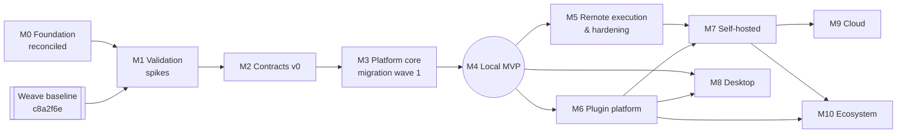

# Master Roadmap

Status: **accepted** (2026-10-25; supersedes the Stage 0–8 outline of 2026-10-24, mapped in [§ Stage mapping](#stage-mapping)).

A milestone starts when its dependencies are met and ends when its exit criteria are met and recorded. **No dates and no delivery commitments.** Milestones may overlap where dependencies allow.

Features are referenced by catalog ID without the `FEAT-` prefix ([feature catalog](../product/FEATURE_CATALOG.md)). Epics and Work Packages: [WORK_PACKAGES](WORK_PACKAGES.md).

**Current position:**
- **M0 complete** (2026-10-25): the product owner reviewed the planning package and accepted ADRs 0002–0005 and 0008–0039; a second pass the same day closed the residual questions Q23–Q54 with ADRs 0040–0043 (superseding 0014, 0019, 0020 and 0027). No open questions remain.
- **Tracking:** every Work Package, epic and scheduled feature has a GitHub issue ([backlog map](../engineering/backlog-map.md), [delivery workflow](../engineering/delivery.md)).
- **Next: M1** validation spikes and license texts. Weave is used as-is from its baseline commit (ADR-0032).

## Overview

| Milestone | Objective | Prerequisite for |
|---|---|---|
| M0 | Consistent product, architecture and delivery plan | M1 |
| M1 | Validate the accepted decisions with spikes; license texts in effect | M2, M3 |
| M2 | Contracts and generated SDK | M3, M4, M6 |
| M3 | Amaru Platform core running headless with Policy and Approval | M4 |
| **M4** | **Local MVP: the supervised delivery flow in Amaru Web on three OSes** | M5, M6, M8 |
| M5 | Separate and remote Workers; execution hardening | M7 |
| M6 | Plugins with TypeScript SDK | M7, M8, M10 |
| M7 | Self-hosted for small teams | M9, M10 |
| M8 | Desktop client | — |
| M9 | Cloud | — |
| M10 | Plugin registry and distribution | — |

## M0 Foundation reconciled
- **Objective:** one consistent planning baseline in this repository.
- **Outcome (engineering):** the documents below are complete and cross-linked; `make check` is green:
  - PRD, feature catalog, NFRs, glossary
  - architecture views, ADR-0009 … 0043 (accepted; 0014, 0019, 0020 and 0027 superseded), closed open questions
  - this roadmap, Work Packages, repository assessment, migration plan
- **Features:** none (planning only).
- **Dependencies:** none.
- **Work Packages:** WP-M0-01.
- **Exit criteria:**
  - Product owner review recorded (done 2026-10-25).
  - ADRs 0002–0005 and 0008–0043 accepted (done 2026-10-25).
  - License decided ([ADR-0026](adr/0026-fair-code-community-license-with-commercial-licensing.md)).
- **Validation:** `make check`; traceability checks described in [§ Feature traceability](#feature-traceability).
- **Risks:** planning drifting from Weave reality, mitigated by refreshing the inventory at M1.
- **Deferred:** all implementation.

## M1 Decisions and spikes
- **Objective:** validate the accepted decisions before code moves, and put the license in effect.
- **Decisions (done 2026-10-25):** every architecture question is closed by an accepted ADR (0014–0039; [OPEN_QUESTIONS](OPEN_QUESTIONS.md)). M1 no longer chooses technology.
- **Outcome (engineering):**
  - Storage and execution spike: bundled PostgreSQL ([ADR-0015](adr/0015-postgresql-is-the-only-database-bundled-in-compact-installs.md)) + embedded NATS JetStream ([ADR-0016](adr/0016-nats-jetstream-message-bus-embedded-in-compact-installs.md)) + own state machine with outbox ([ADR-0042](adr/0042-durable-execution-with-explicit-restart-semantics.md)) run the representative Workflow with forced crashes in every Step state on Windows, macOS and Linux; install footprint recorded against the NFR-34 budget (≤ 120 MB increment); `embedded-postgres` v2 validated as the supervisor (A12).
  - Worker protocol draft as Protobuf schemas (`amaru.worker.v1`, [ADR-0029](adr/0029-worker-protocol-over-websocket-and-protobuf.md)) and the contract versioning rules in fixtures ([ADR-0025](adr/0025-api-and-protocol-versioning-policy.md)).
  - Approval, Policy, roles and configuration shapes drafted for M2 ([ADR-0036](adr/0036-approvals-bind-to-evidence-and-gate-work.md), [ADR-0037](adr/0037-one-policy-evaluates-capabilities-grants-and-approvals.md), [ADR-0038](adr/0038-roles-teams-and-separation-of-duties.md), [ADR-0039](adr/0039-configuration-scopes-and-resolution-order.md)).
  - A refreshed Weave inventory at the baseline `feat/orkestra-dogfood` @ `c8a2f6e` ([ADR-0032](adr/0032-migration-baseline-is-orkestra-dogfood-c8a2f6e.md)); Weave findings F-27, F-39, F-40, F-41 written as Amaru acceptance tests.
- **License tasks (product owner, [ADR-0026](adr/0026-fair-code-community-license-with-commercial-licensing.md)):** legal review of the Amaru Community License 1.0 draft; add `LICENSE` files (community license at the root, Apache-2.0 in contract and SDK packages); CLA text and tooling; trademark search for "Amaru"; vulnerability disclosure policy (`SECURITY.md`) before the first public release.
- **Features:** none implemented.
- **Unblocks:** API-001, EXE-002, PRJ-005, POL-001 and REV-001.
- **Dependencies:** M0. No Weave-side work is required.
- **Work Packages:** WP-M1-01 … WP-M1-07.
- **Exit criteria:** spike reports in `docs/architecture/investigations/` show the validation checks A2 and A9 pass (or a superseding ADR is accepted); LICENSE files added by the product owner; MIGRATION_PLAN §5 criteria 1, 2 and 7 met for the first wave.
- **Validation:** spike reports with crash-injection results and install footprint per OS.
- **Risks:**
  - bundled PostgreSQL blocked on Windows/macOS (A2), mitigated by an installer-managed PostgreSQL service as fallback;
  - license review delays migration, mitigated by migrating only after LICENSE files exist.
- **Deferred:** nothing undecided; implementation of later decisions follows their milestones.

## M2 Contracts v0
- **Objective:** the stable surface every later component builds on.
- **Outcome (engineering):**
  - `packages/contracts`: public API, events, provider protocol, Worker protocol draft, Approval/Policy shapes, with valid/invalid fixtures validated in Go and TypeScript.
  - `packages/sdk`: generated TypeScript client.
- **Features:** API-001, API-002, API-003.
- **Requirements:** FR-40, NFR-2.
- **Dependencies:** M1 (versioning [ADR-0025](adr/0025-api-and-protocol-versioning-policy.md), Approval/Policy [ADR-0036](adr/0036-approvals-bind-to-evidence-and-gate-work.md)/[ADR-0037](adr/0037-one-policy-evaluates-capabilities-grants-and-approvals.md), metadata split [ADR-0043](adr/0043-project-definitions-in-git-teams-and-operational-state-in-platform.md)). Adapting Weave `protocol/` requires its migration ADR (ADR-0011).
- **Work Packages:** WP-M2-01 … WP-M2-03.
- **Exit criteria:**
  - Every Weave route needed for M3/M4 is in the contract.
  - A drift test compares server routes with the spec (it fails today on Weave's `/work-packages/{id}/autoloop`).
  - The SDK generation staleness check is in `make check`.
- **Validation:** fixture tests in both languages.
- **Risks:** freezing too early. Mitigation: the URL major is `/v1` from M2, while the contract package stays `0.x` and may change incompatibly until the Local MVP release; it becomes `1.0.0` at M4, and from then on ADR-0025's additive-only rule applies.
- **Deferred:** plugin manifest schema (M6), identity endpoints (M7).

## M3 Platform core
- **Objective:** the Amaru Platform running headless: the Weave Runtime core adapted, plus Policy, Approval, storage and the embedded Worker interface.
- **Outcome (engineering):**
  - `services/platform` passes the ported Weave behavior tests, the architecture test and the crash-injection suite.
  - Work, Workflows and Executions are driven through the API on PostgreSQL with the NATS bus and outbox.
- **Features:** PRJ-001, PRJ-002, PRJ-003, PRJ-005, WRK-001, WRK-002, WRK-003, WFL-001, WFL-002, WFL-003, WFL-004, EXE-001, EXE-002, EXE-003, EXE-004, EXE-005, EXE-006, API-005, AGT-001, AGT-002, AGT-003, AGT-004, SKL-001, SKL-002, CAP-001, CAP-002, CAP-003, CAP-004, CAP-005, ENV-001, ENV-010, REV-001, REV-003, ART-001, ART-002, ART-003, OBS-001, IAM-001, POL-001, POL-002, POL-003, POL-004, POL-005, POL-006, POL-007, OPS-002, OPS-003.
- **Requirements:** FR-1, FR-2, FR-10 … FR-13, FR-20 … FR-24, FR-30, FR-31; NFR-3, NFR-4, NFR-5, NFR-6, NFR-9, NFR-11, NFR-35.
- **Dependencies:** M2; migration ADRs for `domain`/`ports`, `app`, `provider/*`, `platform`, `store` (reimplemented on PostgreSQL with the outbox, [ADR-0015](adr/0015-postgresql-is-the-only-database-bundled-in-compact-installs.md)), `transport/httpapi`.
- **Work Packages:** WP-M3-01 … WP-M3-07.
- **Exit criteria:**
  - Ported tests are green on Linux, macOS and Windows.
  - The crash-injection suite passes.
  - Ungranted Capability use is refused.
  - Approval waits survive restarts.
  - Codex and OpenCode refuse unenforceable confinement.
  - No Obsidian, Weave or vendor identifiers remain in the core packages.
- **Validation:** `make check` with fakes; a recorded headless run per OS with a real agent provider.
- **Risks:**
  - Weave file-store semantics vs PostgreSQL transactions (store is reimplemented with Weave tests as specification);
  - Windows process-tree semantics (GAP-05);
  - scope creep into delivery-loop changes, which stay in M4.
- **Deferred:** remote Workers, parallel branches, retries (M5).

## M4 Local MVP
- **Objective:** the first useful Amaru product: one engineer runs the supervised delivery flow (UC-1) from Amaru Web on their own machine.
- **Outcome (user-visible):** the engineer installs Amaru, opens the Web UI, and then:
  1. attaches a Project with a linked repository;
  2. creates a Work Package with Local Checks and a review Workflow;
  3. lets the delivery loop implement in a worktree, check, review with evidence, and open a draft PR;
  4. approves in the inbox;
  5. sees diff, Evidence and cost;
  6. merges on GitHub themselves.
- **Features:** PRJ-004, WRK-004, WRK-005, VAL-001, VAL-002, VAL-003, REV-002, REV-004, REV-005, REV-006, OBS-002, OBS-003, CLI-001, CLI-002, CLI-003, CLI-004, CLI-005, CLI-006, CLI-007, INT-001, INT-002, OPS-001, ADM-001.
- **Requirements:** FR-4, FR-16, FR-17, FR-25, FR-33 (per step), FR-34, FR-41; NFR-1, NFR-13, NFR-14, NFR-26, NFR-37, NFR-38.
- **Dependencies:** M3; local Web authentication per [ADR-0034](adr/0034-local-web-client-authentication-with-launch-code-and-cookie.md); migration ADR for the Weave prototype's dashboard assets (license settled by [ADR-0026](adr/0026-fair-code-community-license-with-commercial-licensing.md)).
- **Work Packages:** WP-M4-01 … WP-M4-07.
- **Exit criteria:**
  - PRD §12 criteria met.
  - Recorded supervised runs on Linux, macOS and Windows against a real Go repository.
  - Each accepted change uses at most one implementation and one review run, with cost recorded.
  - An audit walkthrough reconstructs one change end to end.
  - Accessibility checks pass on core flows.
- **Validation:** unit, contract, end-to-end browser tests; recorded manual runs per OS.
- **Risks:**
  - browser-to-loopback security;
  - prototype UI carrying unbacked pages (NFR-38);
  - the delivery loop still needing humans often (acceptable: supervised by design).
- **Deferred:** Desktop, remote Workers, plugins, multi-user.
- **At exit:** the Weave Obsidian plugin is replaced for daily use; the owner may archive `weave-obsidian` ([ADR-0031](adr/0031-obsidian-plugin-is-retired.md)).

## M5 Remote execution and execution hardening
- **Objective:** Steps run on other machines safely; execution becomes robust beyond one process.
- **Outcome:** a Windows VM with Unreal Engine 5 and a Linux sandbox Worker register outbound and run Steps routed by Capability and label. An agent uses the Unreal Editor's MCP tools through the Worker, under Policy and audit. Leases recover from disconnects. Retries, parallel branches, scheduling and quota handling work.
- **Features:** WFL-005, WFL-006, EXE-007, EXE-008, API-004, SKL-004, ENV-002, ENV-003, ENV-004, ENV-005, ENV-006, ENV-007, ENV-008, ENV-009, ENV-011, ENV-013, CAP-006, VAL-004, VAL-005, VAL-006, IAM-006, ART-004.
- **Requirements:** FR-14, FR-43; NFR-10, NFR-11, NFR-25, NFR-29.
- **Dependencies:** M4; [ADR-0029](adr/0029-worker-protocol-over-websocket-and-protobuf.md) (transport), [ADR-0024](adr/0024-remote-worker-registration-identity-and-delivery.md) (enrollment), [ADR-0017](adr/0017-content-addressed-artifact-store-filesystem-or-s3.md) (filesystem adapter at least), [ADR-0035](adr/0035-agents-run-beside-environment-hosted-tools.md) (agent placement).
- **Work Packages (epic level):**
  - E5.1 Worker protocol implementation ([#31](https://github.com/rluders/amaru/issues/31))
  - E5.2 Environment registry and routing ([#32](https://github.com/rluders/amaru/issues/32))
  - E5.3 Leases and partition tests ([#33](https://github.com/rluders/amaru/issues/33))
  - E5.4 Sandbox Environment (single-level rootless containers) ([#29](https://github.com/rluders/amaru/issues/29))
  - E5.5 UE5 + MCP pilot on a Windows VM: interactive-session Worker, editor health, Environment-hosted MCP through the gateway ([#28](https://github.com/rluders/amaru/issues/28))
  - E5.6 Retries/parallelism/scheduling ([#34](https://github.com/rluders/amaru/issues/34))
- **Exit criteria:** partition suite green; a recorded UE5 run on a Windows VM where an agent completes a Work Item using the editor's MCP tools, with every MCP call audited and cancellation working; the embedded and remote Workers pass the same assignment tests.
- **Risks:** editor stability and interactive sessions (R12); GPU and license cost (R13); network and proxy diversity.
- **Deferred:** on-demand provisioning of Environments (M7, ENV-014); managed Cloud Workers (M9).

## M6 Plugin platform
- **Objective:** third parties extend Amaru in TypeScript without touching core code.
- **Outcome:** example plugins installed from a file:
  - UI panel + logic: Artifact viewer + event reaction;
  - Worker adapter: a Provider.
  Each runs with enforced permissions in Web (and in Desktop at M8).
- **Features:** PLG-001, PLG-002, PLG-003, PLG-004, PLG-005, PLG-006, PLG-007, PLG-008.
- **Requirements:** FR-42; NFR-18, NFR-27, NFR-28.
- **Dependencies:** M4 (UI), M2 contracts; [ADR-0041](adr/0041-isolation-tiers-for-plugins-providers-and-steps.md), [ADR-0040](adr/0040-plugin-logic-runs-in-a-separate-plugin-host-process-built-with-javy.md), [ADR-0021](adr/0021-plugin-packaging-signing-permissions-and-compatibility.md) (signing), ADR-0005, ADR-0012; Javy + Amaru Javy plugin toolchain validated in the M6 spike (A10).
- **Work Packages (epic level):**
  - E6.1 Manifest schema and registry ([#36](https://github.com/rluders/amaru/issues/36))
  - E6.2 Permissions and consent ([#37](https://github.com/rluders/amaru/issues/37))
  - E6.3 TypeScript SDK ([#38](https://github.com/rluders/amaru/issues/38))
  - E6.4 UI extension host ([#39](https://github.com/rluders/amaru/issues/39))
  - E6.5 Logic extension host ([#40](https://github.com/rluders/amaru/issues/40))
  - E6.6 Adapter components (including MCP servers shipped as `worker-adapter` components) ([#30](https://github.com/rluders/amaru/issues/30))
- **Exit criteria:** example plugins built only against the SDK; escape tests pass; a plugin exceeding its permissions is blocked.
- **Risks:** sandbox maturity on Windows; SDK churn (the SDK stays pre-1.0 until M8).
- **Deferred:** registry (M10), service plugins (M7).

## M7 Self-hosted
- **Objective:** a small team runs Amaru on its own server.
- **Outcome:**
  - An operator installs, upgrades, backs up and restores Amaru.
  - Users sign in, belong to an Organization and have roles.
  - Separation of duties is enforced.
  - Issue intake, webhooks and templates work.
  - Costs are attributed.
- **Features:** PRJ-006, ENV-014, WFL-007, WFL-008, WFL-009, AGT-005, SKL-003, REV-007, OBS-004, OBS-005, OBS-006, IAM-002, IAM-003, IAM-004, IAM-005, POL-008, PLG-009, CLI-012, INT-003, INT-004, OPS-004, OPS-005, OPS-006, ADM-002, ADM-003.
- **Requirements:** FR-3, FR-15, FR-33 (aggregation), FR-44, FR-46, FR-47; NFR-7, NFR-15 (server figure), NFR-24, NFR-31, NFR-32.
- **Dependencies:** M5, M6; [ADR-0028](adr/0028-identity-local-accounts-oidc-and-opaque-tokens.md), [ADR-0023](adr/0023-self-hosted-oci-image-atlas-migrations-operator-owned-backup.md), [ADR-0038](adr/0038-roles-teams-and-separation-of-duties.md), [ADR-0039](adr/0039-configuration-scopes-and-resolution-order.md); first provisioner (Proxmox VE).
- **Work Packages (epic level):**
  - E7.1 Identity and Organizations ([#43](https://github.com/rluders/amaru/issues/43))
  - E7.2 External PostgreSQL, NATS and S3-compatible configuration (same adapters as compact; [ADR-0015](adr/0015-postgresql-is-the-only-database-bundled-in-compact-installs.md)) ([#44](https://github.com/rluders/amaru/issues/44))
  - E7.3 Packaging, upgrade and restore ([#45](https://github.com/rluders/amaru/issues/45))
  - E7.4 Team workflows (templates, SoD, intake) ([#42](https://github.com/rluders/amaru/issues/42))
  - E7.5 Observability and cost attribution ([#46](https://github.com/rluders/amaru/issues/46))
  - E7.6 CLI client ([#47](https://github.com/rluders/amaru/issues/47))
  - E7.7 Security disclosure process ([#48](https://github.com/rluders/amaru/issues/48))
  - E7.8 Environment templates and provisioning (start on demand, idle stop, snapshot reset, provisioner plugins) ([#49](https://github.com/rluders/amaru/issues/49))
- **Exit criteria:**
  - Recorded install/upgrade/restore drill on a reference host.
  - Tests prove there are no cross-Organization reads.
  - A load test validates the NFR-15 server figure (50 users, 20 Workers, 20 concurrent Steps).
- **Risks:** operator burden from dependencies (NFR-39).
- **Deferred:** distributed self-hosted (M9, with the NATS cluster and Helm chart), Cloud.

## M8 Desktop
- **Objective:** a native workspace over the same UI.
- **Outcome:** Desktop builds for three OSes that:
  - manage several Instances;
  - keep credentials in the OS keychain;
  - optionally supervise a local Platform;
  - host plugin UI;
  - deliver native notifications.
- **Features:** IAM-007, CLI-008, CLI-009, CLI-010, CLI-011.
- **Requirements:** FR-45; NFR-28, NFR-30.
- **Dependencies:** M4 UI packages, M6 extension host; [ADR-0018](adr/0018-desktop-shell-is-tauri-v2.md) with a validation spike (sidecar, keychain, signed updater).
- **Work Packages (epic level):**
  - E8.1 Tauri validation spike for [ADR-0018](adr/0018-desktop-shell-is-tauri-v2.md) (sidecar, keychain, signed updater); a failure leads to a superseding ADR ([#50](https://github.com/rluders/amaru/issues/50))
  - E8.2 Shared UI extraction (`packages/app`, `packages/ui`) ([#51](https://github.com/rluders/amaru/issues/51))
  - E8.3 Instance and credential management ([#52](https://github.com/rluders/amaru/issues/52))
  - E8.4 Local Platform supervision and updates ([#53](https://github.com/rluders/amaru/issues/53))
  - E8.5 Signing and release ([#54](https://github.com/rluders/amaru/issues/54))
- **Exit criteria:** recorded install and run per OS; every action goes through the public API; plugins render identically to Web.
- **Risks:** signing and notarization costs; webview differences.
- **Note:** no Obsidian client is built ([ADR-0031](adr/0031-obsidian-plugin-is-retired.md)).

## M9 Cloud
- **Objective:** a managed deployment where work continues without the user's workstation (UC-6).
- **Outcome:** a tenant-isolated pilot with managed and customer-run Workers.
- **Features:** ENV-012, POL-009, OPS-007, OPS-008.
- **Requirements:** NFR-8, NFR-12, NFR-33.
- **Dependencies:** M7; [ADR-0022](adr/0022-cloud-tenancy-row-level-isolation-by-organization.md) (row-level tenancy), [ADR-0016](adr/0016-nats-jetstream-message-bus-embedded-in-compact-installs.md) (NATS cluster), [ADR-0042](adr/0042-durable-execution-with-explicit-restart-semantics.md) at scale; vendor hosting under the commercial license ([ADR-0026](adr/0026-fair-code-community-license-with-commercial-licensing.md)).
- **Work Packages (epic level):**
  - E9.1 Threat model and cross-tenant isolation test suite for [ADR-0022](adr/0022-cloud-tenancy-row-level-isolation-by-organization.md) ([#56](https://github.com/rluders/amaru/issues/56))
  - E9.2 Cloud adapters ([#57](https://github.com/rluders/amaru/issues/57))
  - E9.3 Managed Worker pools ([#59](https://github.com/rluders/amaru/issues/59))
  - E9.4 Operations and SLOs ([#58](https://github.com/rluders/amaru/issues/58))
- **Exit criteria:** threat model reviewed; cross-tenant isolation test suite green; pilot validated against the initial targets (99.9 % API availability, RPO ≤ 15 min, RTO ≤ 4 h; NFR-33).
- **Deferred:** billing (P3).

## M10 Ecosystem
- **Objective:** plugins discoverable and trustworthy beyond one installation.
- **Features:** PLG-010.
- **Dependencies:** M6, M7; [ADR-0021](adr/0021-plugin-packaging-signing-permissions-and-compatibility.md) (OCI distribution and signing).
- **Exit criteria:** signed packages installed from a registry with provenance shown; the private registry path for self-hosted works.
- **Deferred:** commercial plugin licensing (P3).

## Critical path and blocking decisions

Critical path to the Local MVP:

**M0 (done) → M1 (validation spikes, license texts) → M2 contracts → M3 migration wave 1 → M4 (Web client with launch-code auth) → Local MVP.**

All decisions are taken (2026-10-25). What remains on the path are **validations** and **owner tasks**:

| Item | Blocks | Owner | Notes |
|---|---|---|---|
| License texts and LICENSE files ([ADR-0026](adr/0026-fair-code-community-license-with-commercial-licensing.md)) | Every migration (M2 contracts adapt from Weave, M3, M4 dashboard) | Product owner (+ legal) | Highest schedule risk; the decision itself is made |
| Storage/execution spike: bundled PostgreSQL, embedded NATS, crash suite (A2, A9) | M3 | Engineering | Failure → superseding ADR |
| Weave inventory refresh at `c8a2f6e` ([ADR-0032](adr/0032-migration-baseline-is-orkestra-dogfood-c8a2f6e.md)) | First migration ADR | Engineering | No Weave-side work required |
| Local Web auth security review ([ADR-0034](adr/0034-local-web-client-authentication-with-launch-code-and-cookie.md)) | M4 | Engineering | |
| Remote Worker + UE5 pilot (A5, A8) | M5 exit | Engineering | |
| Plugin toolchain spike: Javy + Amaru Javy plugin, plugin-host process (A10) | M6 | Engineering | |
| Upgrade/restore drill | M7 exit | Engineering | |
| Tauri validation spike | M8 | Engineering | Off the MVP critical path |
| Cross-tenant isolation tests | M9 exit | Engineering | |

- **Cycles.** The milestone graph is acyclic. Feature dependencies never point to a later milestone; this is checked by script, see the next section.
- **Gaps.**
  - M3 requires migration ADRs, which require the LICENSE files to exist. If legal review stalls, M3 can only proceed by reimplementing, which reverses ADR-0011.
  - M4 adapts the Weave prototype UI, which has no LICENSE file; the copyright holder's consent is recorded in [ADR-0026](adr/0026-fair-code-community-license-with-commercial-licensing.md).
- **Not planned (P2/P3).** All P2/P3 features without a milestone are in the catalog's Backlog or "—", by design.

## Feature traceability

Every P0 and P1 feature maps to exactly one milestone above. The lists per milestone are generated from the [feature catalog](../product/FEATURE_CATALOG.md) table columns, and the following properties are checked whenever either document changes:
1. IDs are unique.
2. Every P0/P1 feature has a milestone between M2 and M8.
3. Every milestone list here equals the catalog's set.
4. No feature depends on a feature in a later milestone.

| Milestone | P0 | P1 | P2 | Total |
|---|---|---|---|---|
| M2 | 3 | — | — | 3 |
| M3 | 47 | — | — | 47 |
| M4 | 23 | — | — | 23 |
| M5 | — | 22 | — | 22 |
| M6 | — | 8 | — | 8 |
| M7 | — | 25 | — | 25 |
| M8 | — | 5 | — | 5 |
| M9 | — | — | 4 | 4 |
| M10 | — | — | 1 | 1 |
| Backlog / unscheduled | — | — | 16 | 16 (+5 P3) |

## Risk register

| ID | Risk | Likelihood / impact | Mitigation | Owner |
|---|---|---|---|---|
| R1 | License text or legal review delays migration (decision made in ADR-0026) | Medium / High | LICENSE files are an M1 exit criterion | Product owner |
| R2 | Weave evolves faster than the inventory | High / Medium | Refresh inventory at M1 and per migration ADR; fixed baseline `c8a2f6e` (ADR-0032) | Engineering |
| R3 | Bundled PostgreSQL and embedded NATS bloat or destabilize compact installs | Medium / High | M1 spike with footprint per OS (A2, A9); NFR-34; fallback in the validation register | Engineering |
| R4 | Delivery loop waste persists (Cycle 7: 6 wasted runs) | Medium / High | WRK-005, OBS-002, M4 exit criterion on runs per accepted change | Engineering |
| R5 | Browser-based local UI security flaws | Medium / High | ADR-0034 controls (launch code, Host/Origin/CSRF checks) and security review before M4 | Engineering |
| R6 | Prototype UI shows unbacked features | High / Medium | NFR-38; prune during adaptation | Engineering |
| R7 | Windows behavior never validated (GAP-05) | High / Medium | OS matrix tests from M3; Windows Worker pilot in M5 | Engineering |
| R8 | Plugin sandboxing harder than expected | Medium / Medium | Wasm-only `logic` in a separate plugin-host process with a small host API (ADR-0040); slots-only UI in v1; heavy work in `worker-adapter` | Engineering |
| R9 | Agent vendor CLIs change behavior | High / Medium | Captured-output tests; provider health checks | Engineering |
| R10 | Scope creep toward the full vision before M4 | Medium / High | P0 definition; out-of-scope list; milestone exit reviews | Product owner |
| R11 | Two codebases diverge during migration | Medium / Medium | Component-by-component migration; Weave freezes migrated components | Both |
| R12 | Interactive tools (Unreal Editor) are unstable or need a desktop session that automation cannot hold | High / Medium | Session and editor health checks; refuse Steps when unhealthy; snapshot reset (ENV-011, ENV-014) | Engineering |
| R13 | Specialized Environments are costly (GPU time, engine and OS licenses, idle VMs) | Medium / Medium | Idle stop, cost attribution per Environment, explicit license-seat limits in the template | Product owner |

## Stage mapping

The 2026-10-24 outline used Stages 0–8. They map as follows:

| Former stage | Now |
|---|---|
| 0 Foundation | M0 |
| 1 Complete Weave cycles | Dropped: Weave is used as-is from `c8a2f6e`; its findings became Amaru acceptance tests (ADR-0032) |
| 2 Architecture study | Done in M0 (Q1–Q54 closed 2026-10-25); M1 validates with spikes |
| 3 Contracts | M2 |
| 8 Migration | Distributed: migration ADRs per component in M2, M3, M4 instead of a final stage |
| Local MVP | M4 (now with a named client and flow) |
| 5 Desktop | M8 (after the MVP; Web is the MVP client) |
| 4 Plugin platform | M6 |
| 6 Self-hosted | M7 |
| 7 Cloud | M9 |
