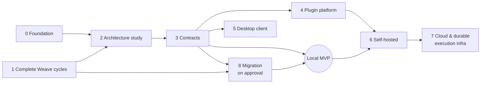

# Architecture Roadmap

Incremental stages from foundation to product. **No dates and no commitments to timing.** A stage starts when its dependencies are met and ends when its exit criteria are met and recorded. Stages may overlap where dependencies allow.

Current position: **Stage 0 in progress** (this repository's bootstrap). Stage 1 runs in parallel in `weave-obsidian`.

## Stage 0 — Product foundation
- **Goal:** product scope, architecture proposal, decision log, governance, Skills, minimal validated tooling.
- **Dependencies:** none.
- **Exit criteria:** PRD, architecture, roadmap, open questions, ADR convention and migration plan reviewed by the product owner; `make check` green; licensing decision requested.
- **Risks:** documentation drifting from reality → `documentation-maintenance` Skill and `doccheck`.

## Stage 1 — Complete the existing Runtime cycles
- **Goal:** finish the outstanding work in `weave-obsidian` **in that repository**: validation of the ADR-012/013 slice, decisions on proposed ADR-017–020, Windows/macOS validation (GAP-05), history hygiene (GAP-07), recorded real-provider runs (GAP-08).
- **Dependencies:** none on Amaru.
- **Exit criteria:** Weave roadmap shows no IN PROGRESS items the migration depends on; the inventory snapshot is refreshed.
- **Risks:** Weave evolving faster than the inventory → refresh the snapshot at the start of stages 2 and 8.

## Stage 2 — Architecture and technology study
- **Goal:** answer the blocking [open questions](OPEN_QUESTIONS.md) (Q1, Q3, Q5, Q10, Q11 first) with spikes and evidence, following the [investigation plan](OPEN_QUESTIONS.md#investigation-plan-for-the-architecture-study).
- **Dependencies:** Stage 0; Stage 1 inventory refresh.
- **Exit criteria:** an ADR (accepted or explicitly rejected) for durable execution, persistence, desktop framework and API versioning; proposed ADRs 0002–0005 and 0008 accepted, revised or rejected.
- **Risks:** turning into an open-ended benchmark → at most two candidates per question, time-boxed by the product owner.

## Stage 3 — Stable Platform APIs and contracts
- **Goal:** the public API, event schema, provider protocol and Worker protocol drafts, with golden fixtures and a compatibility policy; `packages/contracts` introduced.
- **Dependencies:** Stage 2 (Q11, Q1/Q3 shapes).
- **Exit criteria:** contracts published in the repo; fixtures validated in Go and TypeScript; compatibility policy accepted as an ADR.
- **Risks:** freezing contracts too early → contracts stay pre-1.0 until the MVP is validated.

## Stage 4 — Plugin platform
- **Goal:** manifest, permission model, out-of-process Provider hosting, UI extension host; plugin SDK.
- **Dependencies:** Stage 3; Q6, Q7 answered.
- **Exit criteria:** a third-party-style Provider and a UI extension built only against the SDK, running with declared permissions enforced.
- **Risks:** sandboxing harder than expected on Windows → out-of-process with OS-user isolation as the fallback.

## Stage 5 — Desktop client
- **Goal:** the first Amaru Desktop: React UI over the public API, native host supervising the local Platform.
- **Dependencies:** Stage 3; Q5 answered; decision on which client ships first (PRD FR-41).
- **Exit criteria:** installable builds on Windows, macOS, Linux; every action goes through the public API; recorded manual validation per OS.
- **Risks:** webview differences per OS; signing/notarization cost.

## Stage 6 — Self-hosted distribution
- **Goal:** packaged Platform for operators: install, upgrade, backup, restore, identity integration.
- **Dependencies:** Local MVP; Q3, Q9; multi-user identity design.
- **Exit criteria:** documented and tested install/upgrade/restore on a reference environment.
- **Risks:** every infrastructure dependency multiplies operator burden.

## Stage 7 — Cloud and durable execution infrastructure
- **Goal:** evaluate and, if justified, build the managed deployment: tenancy, managed Workers, customer-run Workers, durable execution at scale.
- **Dependencies:** Stage 6; Q1, Q2, Q4, Q8.
- **Exit criteria:** tenancy ADR accepted; threat model reviewed; a pilot deployment validated.
- **Risks:** Cloud requirements leaking into the local product → same contracts, adapters per deployment (ADR-0002).

## Stage 8 — Migration of the existing implementation
- **Goal:** move selected Weave code and behavior into Amaru per the [migration plan](../migration/MIGRATION_PLAN.md).
- **Dependencies:** Stage 1 exit; Stage 3 contracts; licensing decision (Q12).
- **Exit criteria:** the plan's [readiness criteria](../migration/MIGRATION_PLAN.md#5-readiness-criteria) met **and explicit human approval recorded** (ADR-0007).
- **Risks:** losing history or tests in the move; two diverging codebases → migrate by component with behavior-preserving tests.

## Local MVP (milestone)
Reached when the PRD's MVP requirements are met on Windows, macOS and Linux with one first-party client, validated by tests and recorded manual runs.
